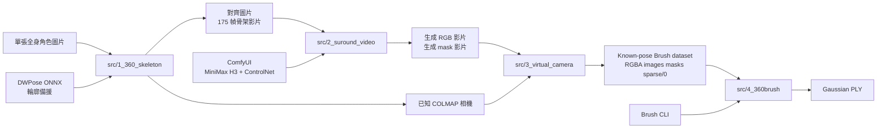
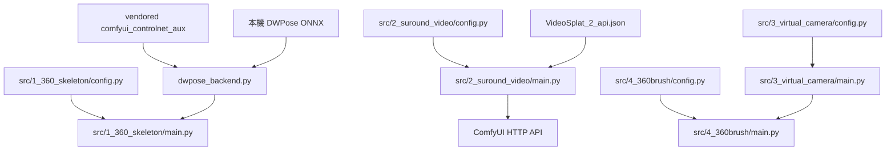
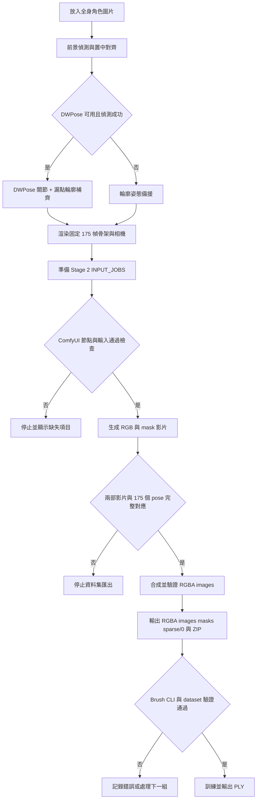

# VideoSplat

**V2.0.0 Release Candidate · Unreleased**

[繁體中文](./README.md) | [English](./README_EN.md) | [CHANGELOG](./CHANGELOG.md) | [GitHub Releases](https://github.com/gkwang4912/VideoSplat/releases) | [V2 架構](./docs/versions/V2_ARCHITECTURE.md) | [V1 → V2 遷移指南](./docs/versions/MIGRATION_V1_TO_V2.md)

| Version | Status | Documentation |
|---|---|---|
| V2.0.0 | Release Candidate / Unreleased | Current README |
| V1.0.0 | Legacy | [V1 中文 README](./docs/versions/README_V1.md) / [English](./docs/versions/README_V1_EN.md) |

## 專案總覽（Project Overview）

VideoSplat V2 是一套以 Python 與檔案交換為核心的研究工具。它從單張全身角色圖片建立固定姿勢的 360° 骨架控制影片與已知相機軌跡，再透過 ComfyUI 生成角色環繞影片及遮罩，將生成影格與原始相機姿態組成 Brush 資料集，最後訓練 3D Gaussian Splatting（3DGS）PLY。

V2 解決從生成影片重新估計不穩定的相機路徑問題：相機軌跡在影片生成前就已確定，後續 RGB、mask 與 COLMAP pose 以相同的 175 幀順序對齊。使用對象是研究單張角色多視角生成、已知姿態資料集與 3DGS 重建的工程師或研究者。

以下三個展示依序使用 V2 的真實 Stage 1 骨架影片、Stage 2 生成影片，以及由 Stage 4 `4.ply` 實際渲染的 Gaussian 模型環繞預覽。

<table>
  <tr>
    <th>175 幀骨架</th>
    <th>生成影像</th>
    <th>生成模型</th>
  </tr>
  <tr>
    <td></td>
    <td></td>
    <td></td>
  </tr>
</table>

- [觀看 175 幀骨架 MP4](docs/assets/demo/v2/pose_control_video_175.mp4)
- [觀看生成影像 MP4](docs/assets/demo/v2/generated_character_video.mp4)
- [觀看生成模型 MP4](docs/assets/demo/v2/gaussian_model_orbit.mp4)
- [查看 V1 原始展示與技術文件](docs/versions/README_V1.md)

## 系統架構說明（Architecture Overview）




模組責任與程式依賴如下。`3_virtual_camera` 的名稱保留自 V2 原始來源，但程式不建立新虛擬相機；它會強制沿用 Stage 1 的 pose。



## 系統流程說明（System Flow）

Stage 1 對每張輸入圖進行前景偵測與置中對齊；DWPose 可用時採用模型關節，漏點以輪廓補齊，模型不可用時整體回退到輪廓估計。系統將固定 3D 骨架投影到 175 個等角度相機，輸出骨架影片、逐幀 PNG、camera JSON 與 COLMAP text model。

Stage 2 只處理 `config.py` 明確列出的 image/video pair。程式先驗證 API workflow 的 `LoadImage`、`LoadVideo`、`SaveVideo` 節點及 ComfyUI `/object_info`，再上傳輸入、排程 prompt、輪詢 history 並下載兩個影片輸出。Stage 3 將 output 1 視為 mask、output 2 視為 RGB，解碼後依 Stage 1 `images.txt` 的原始順序配對。

Stage 3 負責 RGBA 轉換：它將 mask 轉為 `{0, 255}` 二值 alpha，寫入對應 RGB PNG 的 alpha channel，同時保留獨立 `masks/` 供檢查。輸出驗證會逐張確認 RGBA 的 alpha 與 mask 完全一致。Stage 4 預設直接讀取 `src/3_virtual_camera/output/<group>/brush_dataset/`，不再需要人工建立 RGBA 或複製 dataset。



## 資料夾結構說明（Folder Structure）

```text
VideoSplat/
├── src/
│   ├── 1_360_skeleton/
│   │   ├── main.py
│   │   ├── config.py
│   │   ├── dwpose_backend.py
│   │   ├── models/README.md
│   │   └── third_party/comfyui_controlnet_aux/
│   ├── 2_suround_video/
│   │   ├── main.py
│   │   ├── config.py
│   │   └── workflows/
│   ├── 3_virtual_camera/
│   │   ├── main.py
│   │   └── config.py
│   └── 4_360brush/
│       ├── main.py
│       └── config.py
├── tests/
│   └── test_rgba_handoff.py
├── docs/
│   ├── assets/demo/
│   └── versions/
├── requirements.txt
├── README.md
├── README_EN.md
├── CHANGELOG.md
├── .gitignore
└── .gitattributes
```

- `src/1_360_skeleton/`：角色對齊、骨架估計、固定相機、影片與 COLMAP pose 匯出。
- `src/2_suround_video/`：ComfyUI API client 與 UI/API 兩種 workflow JSON。
- `src/3_virtual_camera/`：RGB/mask 解碼、RGBA 合成、已知 pose 重用、資料驗證及 Brush dataset/ZIP 匯出。
- `src/4_360brush/`：直接讀取 Stage 3 輸出，執行 Brush CLI 檢查、批次訓練、log 與 PLY 匯出確認。
- `tests/`：Stage 3 RGBA composition 與 Stage 3 → 4 handoff 的離線回歸測試。
- `docs/versions/`：V1 快照、V1/V2 版本文件、架構、遷移指南與 Release Notes。
- 各階段的 `input/`、`output/`、模型、虛擬環境與訓練產物只存在本機，受 `.gitignore` 排除。

## 核心模組與重要檔案（Key Modules & Files）

| File | Responsibility | Relationship |
|---|---|---|
| `src/1_360_skeleton/main.py` | 角色對齊、姿態備援、骨架投影、影片/COLMAP/JSON 匯出 | 讀取 Stage 1 config；可呼叫 DWPose backend |
| `src/1_360_skeleton/dwpose_backend.py` | 載入本機 detector/pose ONNX 並輸出身體與手部關節 | 使用 vendored `comfyui_controlnet_aux` |
| `src/2_suround_video/main.py` | 驗證、上傳、排程、輪詢及下載 ComfyUI 工作 | 讀取 API workflow 與 Stage 2 config |
| `VideoSplat_2_api.json` | 可直接提交的生成、去背、追蹤與雙影片輸出圖 | 由 Stage 2 main 載入 |
| `src/3_virtual_camera/main.py` | 解析 COLMAP text model、解碼影片、二值化 mask、合成及驗證 RGBA dataset | 保留 Stage 1 pose，不執行 camera estimation |
| `src/4_360brush/main.py` | 驗證 Stage 3 RGBA dataset 與 Brush flags、批次訓練、log 與輸出檢查 | 預設直接讀取 Stage 3 output |
| `docs/versions/V2_ARCHITECTURE.md` | V2 技術事實與資料契約基準 | README 與版本文件的技術依據 |

## 安裝與環境需求（Installation & Requirements）

V2 原始環境使用 Python 3.10.22；程式語法至少需要 Python 3.10。Repository 不包含原始 `.pose_env`、模型權重、ComfyUI 或 Brush binary。

```powershell
python -m venv .venv
.\.venv\Scripts\Activate.ps1
python -m pip install --upgrade pip
python -m pip install -r requirements.txt
```

另外安裝 FFmpeg 並確保 `ffmpeg` 位於 PATH。將下列 DWPose 模型放到 `src/1_360_skeleton/models/yzd-v/DWPose/`：

- `yolox_l.onnx`
- `dw-ll_ucoco_384.onnx`

Stage 2 需要可連線的 ComfyUI。Workflow 實際引用 MiniMax H3 UNet/VAE/text encoder、Pika H3 LoRA、MiniMax H3 Fun ControlNet model patch、BiRefNet 及 SAM3.1 checkpoint；完整檔名以兩份 workflow JSON 為準。ComfyUI 與 custom nodes 的精確版本尚未定義。

Stage 4 需要支援程式檢查之 flags 的 Brush CLI。若 Brush 不在 PATH，設定：

```powershell
$env:VIDEOSPLAT_BRUSH_EXE = 'C:\path\to\brush-cli.exe'
```

本專案沒有必要的雲端 API Key 或 `.env`。ComfyUI 預設網址是 `http://127.0.0.1:8188`。

## 使用方式（How to Use）

所有命令從 Repository 根目錄執行。Stage 4 會直接讀取 Stage 3 output；前兩個 handoff 仍需依下列目錄準備檔案。

1. 將 PNG/JPG/JPEG/WEBP/BMP 全身圖放入 `src/1_360_skeleton/input/`，執行：

   ```powershell
   python -B src/1_360_skeleton/main.py
   ```

2. 對每個角色，將 Stage 1 的 `source_aligned.png` 與 `pose_control_video_175.mp4` 放到 `src/2_suround_video/input/<group>/`，並同步修改 `src/2_suround_video/config.py` 的 `INPUT_JOBS`。先檢查，再生成：

   ```powershell
   python src/2_suround_video/main.py --check
   python src/2_suround_video/main.py
   ```

3. 在 `src/3_virtual_camera/input/<group>/` 放入 Stage 2 的 `*_output_1_*.mp4` mask 影片、`*_output_2_*.mp4` RGB 影片，以及 Stage 1 的 `colmap/sparse/0/`，執行：

   ```powershell
   python src/3_virtual_camera/main.py
   ```

4. Stage 3 會在 `src/3_virtual_camera/output/<group>/brush_dataset/` 建立已驗證的 RGBA dataset。Stage 4 預設直接讀取該目錄：

   ```powershell
   python src/4_360brush/main.py
   ```

成功時，Stage 4 會在 `src/4_360brush/output/<group>/` 產生 PLY 與 `brush.log`。外部 GPU、模型與服務相關的失敗不會被文件驗證取代，必須在目標環境實際測試。

## 設定說明（Configuration）

| Location | Setting | Effect |
|---|---|---|
| `src/1_360_skeleton/config.py` | 尺寸、FPS、175 幀、相機半徑/高度/目標、焦距、固定關節、DWPose 開關 | 控制骨架、相機與 Stage 1 輸出 |
| `src/2_suround_video/config.py` | ComfyUI URL、`INPUT_JOBS`、workflow、timeout、output prefix | 控制提交的角色配對與 API 行為 |
| `VideoSplat_2_api.json` | 模型、prompt、control、sampling、去背、追蹤與保存節點 | 控制實際生成與兩部影片輸出 |
| `src/3_virtual_camera/config.py` | 影片 glob、175 幀、mask threshold/erosion、RGBA、ZIP、overwrite | 控制資料集建立與不可變 camera policy |
| `src/4_360brush/config.py` | Stage 3 input、steps、splat cap、解析度、SH、seed、alpha、eval、export、批次策略 | 控制 Brush 訓練命令 |
| `VIDEOSPLAT_BRUSH_EXE` | Brush executable path | 覆寫 PATH 自動尋找結果 |
| `VIDEOSPLAT_BRUSH_INPUT_DIR` | Brush group input root | 覆寫預設的 Stage 3 output 位置 |

不要把 `REUSE_ORIGINAL_CAMERA_POSES` 改為 false，或啟用 camera estimation/optimization/feature matching；Stage 3 會將這些視為違反 V2 實驗不變條件並停止。

## 開發者指南（Developer Guide）

建議閱讀順序是 `src/1_360_skeleton/config.py` → `main.py` → `dwpose_backend.py`，接著閱讀 Stage 2 config/main/API workflow，再閱讀 Stage 3 的 dataclass、COLMAP parser、frame extraction、RGBA composition 和 validation，最後閱讀 Stage 4 command builder。

修改時注意以下資料契約：Stage 1 的 frame count、影像名稱、相機內參與 `images.txt` 順序必須與 Stage 2/3 一致；Stage 2 若新增或調整 `SaveVideo`，必須同步 Stage 3 的 mask/RGB glob；更改 COLMAP image name 時不得在 Stage 3 重新命名而破壞 registered name；更改 Brush flags 時要同步 `REQUIRED_FLAGS` 與版本偵測。

擴充功能時優先新增明確的設定與驗證，不要隱式搜尋任意輸入。若要建立自動 handoff，應保留現有每階段可獨立執行及可檢查中間檔案的特性。第三方 DWPose runtime 位於 `third_party/`，其授權文件與專案自身授權應分開處理。

## 已知限制與待辦事項（Limitations & TODO）

- V2 只有 `tests/test_rgba_handoff.py` 涵蓋 RGBA composition 與 Stage 3 → 4；其餘流程仍缺少自動化與端到端測試。
- V2 沒有 Viewer；V1 Viewer 只存在於 `v1.0.0`。
- Stage 1 → 2 與 Stage 2 → 3 仍需手動準備資料，且 Stage 2 的 `INPUT_JOBS` 需要手動編輯；Stage 3 → 4 已直接串接。
- Stage 3 固定要求 175 幀，不支援不同長度或 pose 重採樣。
- Stage 3 會輸出 RGBA 與獨立 mask；此轉換已具備離線測試，但仍需在實際 ComfyUI 輸出與 Brush 環境完成端到端驗證。
- DWPose、ComfyUI 與 Brush 依賴外部模型或執行檔，尚無單一可重現環境 lockfile。
- `points3D.txt` 可為空；Brush 會使用 random initialization。
- 專案根目錄尚無 LICENSE；只有 vendored 第三方程式附帶其自身授權。
- 專案自有 Python/JSON 中沒有 `TODO`、`FIXME`、`XXX` 或 `NotImplemented` 標記；未完成範圍以上述可驗證限制為準。

## 補充說明（Notes）

`3_virtual_camera` 是既有 V2 目錄名稱。實作會複製並驗證 Stage 1 COLMAP text model，不會呼叫 COLMAP mapper、估計新姿態或產生虛構 3D points。

V2 來源資料夾中的 `.pose_env`、ONNX 模型、輸入圖片、生成影片、ZIP、PLY、log 與 Brush target 都是本機 runtime 資料，未加入 Repository。唯一納入的 V2 Demo 是 Stage 1 `default` 骨架輸出的縮小 GIF、PNG 與 MP4。V1 的程式與根 README 可透過 `v1.0.0` 取得，main 分支中的 V1 快照位於 `docs/versions/`。
