# VideoSplat

**V2.0.0 Release Candidate · Unreleased**

[繁體中文](README.md) | [English](README_EN.md)

## 專案總覽（Project Overview）

VideoSplat 把一張全身角色圖轉成可供 Gaussian Splatting 訓練的多視角資料，再以 Brush 匯出 PLY。這個工作區目前的實作分成五個可獨立執行的 Python 工具：骨架與相機建立、角色影片生成、影片遮罩生成、RGBA 資料集組裝、Gaussian 訓練。

設計重點是先定義相機，再產生受骨架控制的影像。骨架、RGB 影片、mask 影片與相機記錄以逐幀順序配對，避免在生成後另行估計相機。使用者主要是需要檢查控制條件、重建資料契約與 3DGS 結果的研究者及工程師；專案性質為本機研究工具鏈（tool），各階段透過磁碟檔案交接。

### 預覽

<table>
  <tr>
    <th>骨架控制／Skeleton control</th>
    <th>歷史角色展示／Legacy character</th>
    <th>歷史高斯展示／Legacy Gaussian render</th>
  </tr>
  <tr>
    <td>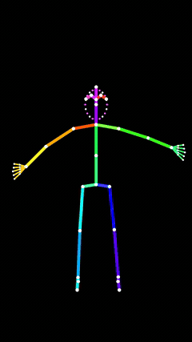</td>
    <td>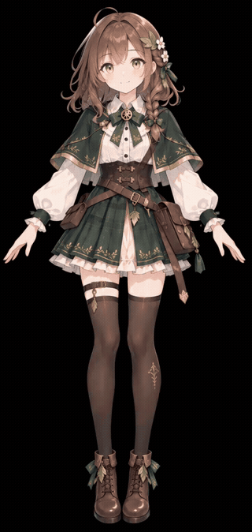</td>
    <td>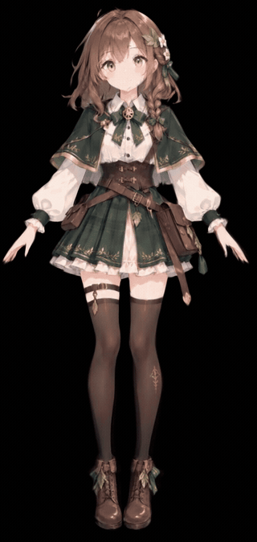</td>
  </tr>
</table>


## 系統架構說明（Architecture Overview）

五個 Stage 各自從同目錄的 `config.py` 讀取路徑與參數。Stage 2、3 是 ComfyUI HTTP client；Stage 1、4 使用 FFmpeg；Stage 5 啟動本機 Brush 執行檔。訓練以外另有 CPU 渲染工具，可從 PLY 與原始 COLMAP 相機重現展示影片。

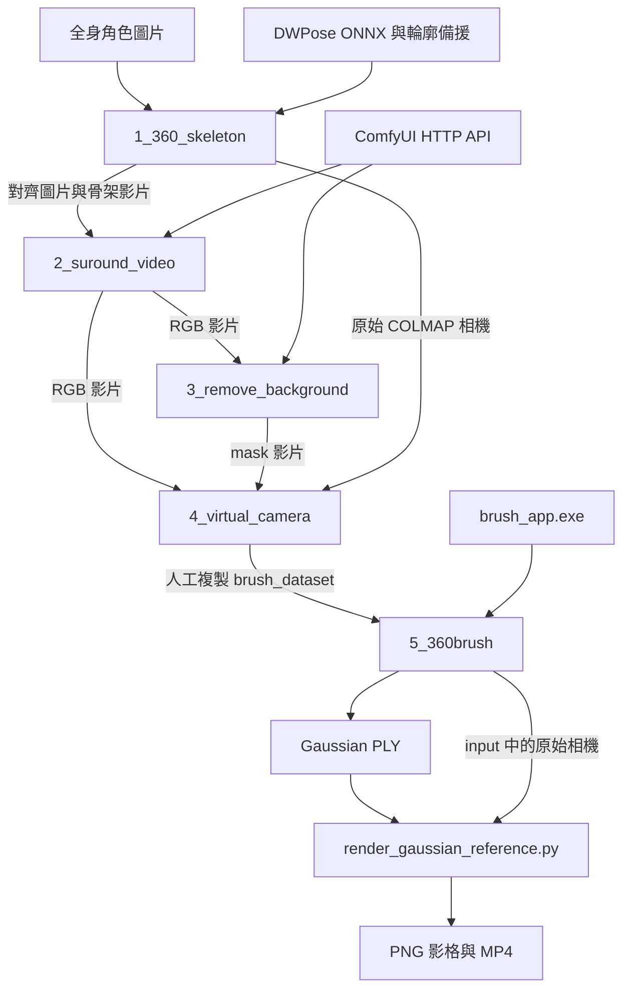


| 邊界 | 上游負責 | 下游要求 |
|---|---|---|
| 1 → 2 | 對齊圖與骨架影片 | 每個第一層角色目錄同時包含兩個固定檔名 |
| 2 → 3 | 生成的 RGB 影片 | 將選定版本放進 Stage 3 input；保留角色子目錄 |
| 1、2、3 → 4 | 原始相機、RGB、mask | 同一角色目錄內提供相機模型與可唯一辨識的影片配對 |
| 4 → 5 | RGBA dataset | 手動複製完整 `brush_dataset/` 到 Stage 5 input |
| 5 → 渲染 | PLY 與訓練時相機 | 明確指定 PLY、COLMAP 路徑及輸出目錄 |

## 系統流程說明（System Flow）

完整處理順序如下：

1. Stage 1 先輸出 `default` 固定骨架，再遞迴處理輸入圖片。前景偵測與置中完成後，採用 DWPose 關節；缺失關節使用輪廓補齊，模型初始化或偵測失敗則改用輪廓備援。
2. Stage 2 掃描第一層子目錄，以 `source_aligned.png` 與 `pose_control_video_175.mp4` 建立工作。檢查 ComfyUI 節點後上傳、提交 prompt、輪詢 history、下載 RGB 影片；目前 API workflow 只有一個 `SaveVideo`。
3. Stage 3 遞迴尋找影片。workflow 以第一幀的 BiRefNet mask 初始化 SAM3 追蹤，再把追蹤結果存成 mask 影片。輸出沿用輸入相對目錄及檔名主體。
4. Stage 4 抽樣影片像素辨識唯一的黑白 mask，再以寬、高、影格數配對唯一 RGB 影片。兩段影片及 COLMAP pose 都必須各有 175 筆；逐幀把 mask 的灰階值寫進 RGB 的 alpha，按原始註冊名稱保存 RGBA PNG。
5. Stage 5 檢查資料夾及 Brush flags，逐組執行訓練、記錄 `brush.log`，確認最後 PLY 存在且非空。渲染工具另行讀取這個 PLY 與原始相機，輸出逐幀影像及影片。

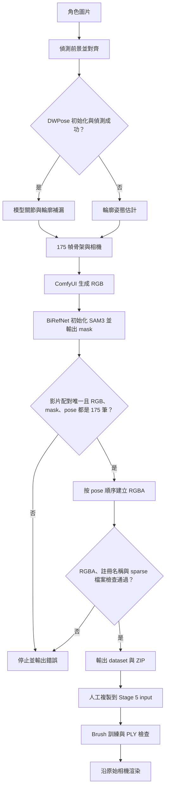

| 情況 | 現有行為 |
|---|---|
| Stage 1 單張圖片處理失敗 | 繼續其他圖片；在 `batch_summary.json` 記錄失敗，最後拋出錯誤 |
| Stage 2 只有一個必要輸入檔 | 回報不完整目錄並停止；完全不含兩個必要檔名的目錄則略過 |
| Stage 2 已完成工作 | 以 workflow、圖片、影片的 SHA-256 簽章及 `.completed.json` 判斷是否可略過 |
| Stage 3 已有同名影片 | 預設略過；`--force` 會重新生成並覆寫，未比對輸入內容簽章 |
| Stage 4 任一組不合法 | 停止整批；先在暫存目錄組裝並驗證，通過後才取代該組 dataset |
| Stage 5 單組失敗 | 預設記錄失敗並繼續下一組；最後以非零結束碼回報 |

## 資料夾結構說明（Folder Structure）

以下結構同時標示程式目錄與目前工作區中的本機資料；不代表這些資料都已納入 Git。

```text
VideoSplat/
|-- src/
|   |-- 1_360_skeleton/
|   |   |-- main.py, config.py, dwpose_backend.py, README.md
|   |   |-- models/yzd-v/DWPose/
|   |   |-- third_party/comfyui_controlnet_aux/
|   |   |-- input/
|   |   `-- output/
|   |-- 2_suround_video/
|   |   |-- main.py, config.py
|   |   |-- workflows/VideoSplat_2.json
|   |   |-- workflows/VideoSplat_2_api.json
|   |   |-- input/
|   |   `-- output/
|   |-- 3_remove_background/
|   |   |-- main.py, config.py
|   |   |-- workflows/Sam3_remove_background.json
|   |   |-- workflows/Sam3_remove_background_api.json
|   |   |-- input/
|   |   `-- output/
|   |-- 4_virtual_camera/
|   |   |-- main.py, config.py
|   |   |-- input/
|   |   `-- output/
|   `-- 5_360brush/
|       |-- main.py, config.py
|       |-- brush_app.exe, brush-cli.exe
|       |-- input/
|       |-- output/
|       `-- target/autotune/
|-- tools/
|   |-- render_gaussian_reference.py
|   |-- render_gaussian_reference.md
|   |-- render_gaussian_orbit.py
|   `-- requirements-renderer.txt
|-- docs/
|   |-- assets/demo/
|   |   `-- v2/
|   `-- versions/
|-- test_file/
|   |-- Avater/black/
|   |-- Avater/white/
|   |-- suround/1/ ... 5/
|   `-- 1080/
|-- requirements.txt
|-- README.md, README_EN.md, CHANGELOG.md
`-- .gitignore, .gitattributes
```

| 位置 | 逐層責任 |
|---|---|
| `src/1_360_skeleton/models/` | 模型說明；`yzd-v/DWPose/` 保存下載的 detector 與 pose ONNX |
| `third_party/comfyui_controlnet_aux/src/custom_controlnet_aux/dwpose/` | vendored 姿態推論；`dw_onnx/` 是 ONNX 前後處理，`dw_torchscript/` 是另一路 TorchScript 實作 |
| 各 Stage 的 `input/`、`output/` | 執行時資料；角色 group 的意義由對應程式的 discovery 函式決定 |
| `src/5_360brush/target/autotune/` | 本機現有的 Brush／CubeCL autotune 快取 |
| `tools/` | PLY 離線渲染程式、重現說明及獨立依賴清單 |
| `docs/assets/demo/`、`v2/` | 舊展示與目前三個內嵌預覽的 GIF、MP4、除錯 PNG |
| `docs/versions/` | V1 文件快照、V1/V2 說明、架構、遷移、release notes 與版本政策；部分內容仍描述先前的四階段設計 |
| `test_file/` | 人物圖片與影片樣本，沒有測試 runner；`Avater`、`suround` 為實際拼字 |
| `test_file/suround/1/ ... 5/` | RGB／mask／角色圖片組；其中第 4 組圖片實際名為 `souce.png` |
| `test_file/1080/` | 三個 `video_latent_refine_*.mp4` 影片樣本 |

Stage 4 交給 Brush 的目錄只有 RGBA 影像與 COLMAP 模型，不含獨立 `masks/`：

```text
src/4_virtual_camera/output/<group>/
|-- brush_dataset/
|   |-- images/frame000.png ... frame174.png
|   `-- sparse/0/
|       |-- cameras.txt
|       |-- images.txt
|       `-- points3D.txt
`-- brush_dataset.zip
```

影像名稱實際沿用 `images.txt`；上例的 `frameNNN.png` 是 Stage 1 預設命名。複製到 Stage 5 後，入口為 `src/5_360brush/input/<group>/brush_dataset/`。

## 核心模組與重要檔案（Key Modules & Files）

| 檔案或函式 | 主要責任與關聯 |
|---|---|
| [Stage 1 main.py](src/1_360_skeleton/main.py) | `camera_for_frame` 建立外參，`write_colmap_model` 匯出相機，`generate_character` 產生影片與診斷資料 |
| [dwpose_backend.py](src/1_360_skeleton/dwpose_backend.py) | 驗證模型大小與 SHA-256、續傳下載、載入 `Wholebody`；避免執行第三方 package 不需要的初始化 |
| [Stage 2 main.py](src/2_suround_video/main.py) | `discover_jobs` 自動配對；`job_signature` 與完成記錄管理重跑；使用標準函式庫呼叫 ComfyUI |
| [生成 API workflow](src/2_suround_video/workflows/VideoSplat_2_api.json) | 32 個節點；MiniMax H3 reference-to-video、骨架 ControlNet、LoRA、記憶體最佳化與單一影片輸出 |
| [Stage 3 main.py](src/3_remove_background/main.py) | 遞迴影片 discovery、串流 multipart 上傳、保留相對目錄的下載與 `--force` 行為 |
| [去背 API workflow](src/3_remove_background/workflows/Sam3_remove_background_api.json) | 12 個節點；`VHS_LoadVideo`、BiRefNet 首幀 mask、SAM3 追蹤與 mask 影片保存 |
| [Stage 4 main.py](src/4_virtual_camera/main.py) | `detect_video_pair` 以內容／規格辨識配對；`write_rgba_images` 合成 alpha；`build_dataset` 驗證與匯出 |
| [Stage 5 main.py](src/5_360brush/main.py) | `detect_steps_flag`、`build_command`、`run_brush` 負責 CLI 相容性、訓練命令與 log |
| [目前預覽渲染器](tools/render_gaussian_reference.py) | 按數字順序讀 SH 欄位、重建協方差、投影橢圓、深度排序與 alpha 混合；要求 `--colmap` |
| [另一個離線腳本](tools/render_gaussian_orbit.py) | 內建自動環繞取景；其 vertical-axis parser 預期數字向量，不能直接處理本次 PLY 的 `Vertical axis: y` |
| [渲染說明](tools/render_gaussian_reference.md) | 描述輸出、相機模式及重現預覽的命令 |

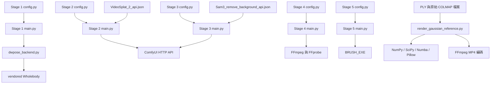

## 安裝與環境需求（Installation & Requirements）

### 執行環境

| 項目 | 可由目前檔案確認的要求 |
|---|---|
| Python | 至少 3.10，Stage 4 使用 `zip(..., strict=True)`；完整相依套件相容版號尚未定義 |
| 作業系統 | 現有 Brush 設定指向 Windows `.exe`；其他系統的完整部署流程尚未定義 |
| FFmpeg / FFprobe | 需在 PATH；Stage 1 編碼、Stage 4 偵測與解碼、渲染器輸出影片使用 |
| ComfyUI | Stage 2、3 各設定預設 `http://127.0.0.1:8188`；必要節點須出現在 `/object_info` |
| GPU / VRAM | 影片模型與 Brush 訓練的最低需求尚未定義；CPU 預覽渲染器不要求 CUDA |
| Brush | 工作區現有 `brush_app.exe` 與 `brush-cli.exe`；Stage 5 實際使用前者，啟動前驗證 flags |

從根目錄安裝 Python 依賴：

```powershell
python -m venv .venv
.\.venv\Scripts\Activate.ps1
python -m pip install -r requirements.txt
python -m pip install -r tools/requirements-renderer.txt
ffmpeg -version
ffprobe -version
```

根 `requirements.txt` 透過 `-r` 引入 vendored requirements，包含 Torch、TorchVision、OpenCV、NumPy、Pillow、SciPy、Hugging Face Hub、MediaPipe、ONNX Runtime 等。渲染清單另外列出 NumPy、SciPy、Pillow、plyfile、Numba。這兩份清單均無完整版本鎖定。

### 模型與服務準備

DWPose 的 `yolox_l.onnx`、`dw-ll_ucoco_384.onnx` 由 backend 在需要時下載到 `models/yzd-v/DWPose/`；合計大小為 351,145,849 bytes。下載以 `.part` 續傳，驗證大小與 SHA-256，最多嘗試三次。也可事先放入符合驗證的檔案。

ComfyUI 的模型實際名稱來自兩個 API workflow：

| 階段 | 模型欄位內容 |
|---|---|
| 生成 | `minimax_h3_ref2va_pruned_int8_convrot.safetensors` |
| 生成 | `minimax_h3_video_vae_int8_convrot.safetensors` |
| 生成 | `qwen3vl_32b_minimax_h3_nvfp4_awq.safetensors` |
| 生成 | `pika_h3_flex_ref2va_comfy_bf16.safetensors` |
| 生成 | `minimax_h3_fun_controlnet_union_pruned_int8_convrot.safetensors` |
| mask | `BiRefNet-general`、`sam3.1_multiplex_fp16.safetensors` |

custom node 安裝來源與精確版本尚未由專案統一規範；以 workflow 的 `class_type` 和各 Stage 的 `--check` 核對節點完整性。`--check` 不會驗證所有模型檔內容，也不代表已完成生成。

沒有專案層級的必要 API key 或 `.env` schema。已使用的環境變數包括 `AUX_ORT_PROVIDERS`；backend 預設設為 `CPUExecutionProvider`。Stage 4 的 `VIDEOSPLAT_BRUSH_EXE` 只影響它印出的建議命令，不會改變 Stage 5 的 `BRUSH_EXE`。

## 使用方式（How to Use）

所有命令從 VideoSplat 根目錄執行。`<group>` 表示同一個角色的資料夾名稱；目前已存在的角色名稱為 `4`。

1. 將角色圖放入 `src/1_360_skeleton/input/`。目前的 `4.png` 會對應 `output/4/`。執行：

   ```powershell
   python -B src/1_360_skeleton/main.py
   ```

   檢查 `source_aligned.png`、`pose_alignment_preview.png` 與 `pose_detection.json`。保留該組 `colmap/sparse/0/`，後續必須沿用。

2. 將該組 `source_aligned.png`、`pose_control_video_175.mp4` 複製到 `src/2_suround_video/input/<group>/`，啟動已備妥節點與模型的 ComfyUI，執行：

   ```powershell
   python -B src/2_suround_video/main.py --check
   python -B src/2_suround_video/main.py
   ```

   RGB 影片下載到 `output/<group>/`。程式自動掃描角色目錄，沒有 `INPUT_JOBS` 名單需要編輯。

3. 將選定的 RGB 影片放進 `src/3_remove_background/input/<group>/`，執行：

   ```powershell
   python -B src/3_remove_background/main.py --check
   python -B src/3_remove_background/main.py
   ```

   相對位置相同的 `output/<group>/` 會產生 mask 影片。需要重做時加 `--force`；這會覆寫對應輸出。

4. 在 `src/4_virtual_camera/input/<group>/` 放入選定 RGB 與 mask，使用不同檔名保存；再放入 Stage 1 的 `colmap/sparse/0/`。執行：

   ```powershell
   python -B src/4_virtual_camera/main.py
   ```

   只放需要配對的影片版本，避免多個 RGB 候選導致歧義。輸出是 `output/<group>/brush_dataset/` 與 ZIP；預設會取代既有 dataset。

5. 把完整 `brush_dataset/` 複製到 `src/5_360brush/input/<group>/brush_dataset/`，確認 `config.py` 的 Brush 路徑後執行：

   ```powershell
   python -B src/5_360brush/main.py
   ```

   預設最終檔為 `src/5_360brush/output/<group>/<group>.ply`，同目錄保留 `brush.log`。`SKIP_COMPLETED=False`，重跑會再次訓練。

### 用訓練相機渲染現有模型

```powershell
python -B tools/render_gaussian_reference.py src/5_360brush/output/4/4.ply src/5_360brush/output/4/source_camera_render --colmap src/5_360brush/input/4/brush_dataset/sparse/0 --width 1080 --height 1920 --fps 24 --supersample 2
```

`--preview` 僅輸出四個診斷視角。正式執行依 `images.txt` 的順序輸出所有影格，並產生 MP4、alpha PNG 與 `render_manifest.json`；manifest 記錄來源雜湊、相機與每幀統計。輸出寬高須保持原相機長寬比。`--frames` 會被實際 pose 數量覆蓋。腳本不會自動替換 README 的 GIF。

## 設定說明（Configuration）

| 位置 | 目前值或項目 | 修改後的影響 |
|---|---|---|
| Stage 1 `config.py` | 720×1280、24 FPS、175 幀；相機半徑 4.8、高度 1.45、焦距 1850 px | 改變控制影片、相機內外參與投影 |
| Stage 1 `config.py` | `USE_DWPOSE`、`POSE_MIN_CONFIDENCE`、前景門檻、`JOINTS`、`DEBUG_FRAMES` | 控制偵測、備援姿態與診斷圖；改幀數時要同步除錯影格索引 |
| Stage 2 `config.py` | 兩個輸入固定檔名、ComfyUI URL、輪詢 2 秒、生成 timeout 6 小時 | 控制 discovery 與 API 等待；HTTP request timeout 為 30 秒 |
| Stage 2 API JSON | prompt、模型、noise seed、0.7 倍且取 32 倍數的影像尺寸、影片長度運算 | 控制生成結果；目前 7.1 秒參數經 expression 對齊為 175 幀，並非直接讀 Stage 1 config |
| Stage 3 `config.py` | 副檔名、上傳 chunk 1 MiB、上傳 timeout 30 分鐘、生成 timeout 6 小時 | 控制遞迴搜尋、串流上傳與服務等待 |
| Stage 3 API JSON | BiRefNet、SAM3 detection threshold 0.5、max objects 4、24 FPS | 控制 mask 初始化、追蹤與保存 |
| Stage 4 `config.py` | 5 個抽樣幀、64×64 分析、灰階比例 0.995、黑白比例 0.98 | 控制 mask 自動辨識，不會把匯出的 alpha 強制二值化 |
| Stage 4 `config.py` | `EXPECTED_FRAMES=175`、`EXPORT_ZIP=True`、`OVERWRITE_OUTPUT=True` | 控制幀數契約、ZIP 與既有資料集取代行為 |
| Stage 5 `config.py` | `BRUSH_EXE=BASE_DIR / "brush_app.exe"` | 指定真正啟動的訓練程式；不是由環境變數自動覆寫 |
| Stage 5 `config.py` | 50,000 steps、10,000,000 splat cap、2048 最大解析度、SH 3、seed 42、alpha weight 0.1 | 組成 Brush 訓練命令；未指定的 optional 參數為 `None`，不傳給 CLI |
| Stage 5 `config.py` | `DRY_RUN`、`SKIP_COMPLETED`、`CONTINUE_ON_ERROR`、`EXTRA_ARGS`、`EXTRA_ENV` | 控制僅列命令、略過、批次失敗處理、額外 flags 與 subprocess 環境 |
| 渲染器 CLI | `--colmap`、尺寸、FPS、超採樣 | 指定原始相機與輸出規格；背景目前寫在程式中，為淺灰色 |

Stage 4 強制 `REUSE_ORIGINAL_CAMERA_POSES=True`、`COMPOSE_RGBA_IMAGES=True`；`ESTIMATE_CAMERAS`、`OPTIMIZE_CAMERAS`、`MATCH_FEATURES`、`EXPORT_SEPARATE_MASKS` 必須是 `False`。違反時 `require_invariants()` 會停止執行。

`BRUSH_ALPHA_MODE="transparent"` 只用於 Stage 4 印出的建議命令。Stage 5 目前 `ALPHA_MODE=None`，實際命令沒有 `--alpha-mode`。Stage 5 的 `NO_TIMEOUT` 設定沒有被 main 讀取，訓練函式本身就未設定 timeout。

## 開發者指南（Developer Guide）

1. 先讀五個 `config.py`，再讀各自 `main()` 與 discovery 函式，確認輸入目錄深度、命名與略過條件。
2. 讀 Stage 1 的 `camera_for_frame`、`write_colmap_model` 和 Stage 4 的 COLMAP parser，理解逐幀對應規則。
3. 讀 Stage 2、3 的 API workflow 及 `prepare_workflow`；UI JSON 用於 ComfyUI 編輯，Python 實際提交 `*_api.json`。兩者不會自動同步。
4. 讀 Stage 4 的 `detect_video_pair`、`write_rgba_images`、`validate_dataset`，再讀 Stage 5 `build_command`，追蹤 alpha 到訓練的交接。
5. 修改渲染時讀 `read_colmap_cameras`、`load_gaussians`、`render`、`rasterize`，以相同原始鏡頭比較修改前後結果。

世界座標使用 `+Y` 向上、`+Z` 為角色正面；COLMAP 外參是 world-to-camera，四元數順序為 `qw,qx,qy,qz`，相機中心為 `C = -Rᵀt`。Stage 1 的第一幀與最後一幀分別對應 0°、360°，因此同為正面。

擴充時沿現有邊界新增設定、驗證與對應輸出。改變幀數必須同步 Stage 1、生成 workflow 長度與 Stage 4 契約；改變檔名必須維持 COLMAP 註冊名稱；改 Brush flags 時要同步 `REQUIRED_FLAGS` 與 steps 偵測。新增跨階段自動搬移功能時，應明確處理重跑與多版本配對。

目前沒有測試目錄或 CI。以下命令可在不啟動模型及服務的情況下檢查自有 Python 與 workflow 語法：

```powershell
python -B -c "import ast,pathlib; files=list(pathlib.Path('src').glob('*/*.py'))+list(pathlib.Path('tools').glob('*.py')); [ast.parse(p.read_text(encoding='utf-8-sig')) for p in files]; print('Python syntax OK')"
python -B -c "import json,pathlib; files=list(pathlib.Path('src').glob('*/workflows/*.json')); [json.loads(p.read_text(encoding='utf-8-sig')) for p in files]; print('Workflow JSON OK')"
```

以上只確認語法。完整驗證仍需在模型、ComfyUI、FFmpeg 與 Brush 都備妥的環境完成。

## 已知限制與待辦事項（Limitations & TODO）

### 已確認的限制

| 範圍 | 目前狀態 |
|---|---|
| 幾何與相機 | 只沿用既有姿態，不做相機估計、最佳化或稀疏特徵重建；Stage 1 的 `points3D.txt` 沒有 3D points |
| 生成一致性 | prompt 與骨架是控制條件，程式沒有驗證角色外觀、姿態與實際視角是否精確遵守 |
| 尺寸契約 | 目前訓練 RGBA 為 512×896，COLMAP 宣告為 720×1280；Stage 4 不檢查兩者尺寸一致，也不重算內參。影響與修正需另行驗證 |
| mask | 以抽樣灰階／黑白比例判別，歧義即停止；輸出 alpha 保留灰階，僅驗證非定值，未檢查每張語意遮罩是否正確 |
| 增量重跑 | Stage 2 有輸入／workflow 簽章；Stage 3 只有同名輸出判斷；Stage 5 預設重新訓練 |
| 驗證強度 | Stage 5 只抽查 PNG header；沒有專案測試套件、CI、端到端自動回歸或統一依賴 lockfile |
| 預覽 | 參考渲染器只接受 `SIMPLE_PINHOLE`／`PINHOLE` 與 SH 0–3；不能補回 PLY 缺失細節，漂浮高斯與模糊邊緣仍會顯示 |
| 樣本資料 | `test_file/suround/4/` 的影片各為 192 幀，不能直接通過目前 175 幀契約；資料夾名稱不是規格保證 |
| 部署與授權 | 最低硬體、完整套件相容矩陣、custom node 固定版本與專案根目錄授權尚未定義 |

### 可追溯的待辦範圍

自有 Python 與 workflow JSON 中未發現 `TODO`、`FIXME`、`XXX` 或 `NotImplemented` 標記。從上述缺口可明確列出的後續工程工作為：

1. 驗證影像尺寸與相機內參的交接，建立可重現的投影對照。
2. 為 175 幀、mask 配對、RGBA、原始 pose 與輸出 PLY 建立離線回歸檢查。
3. 統一各階段的重跑判斷與檔案搬移策略。
4. 固定外部模型、節點、套件及 Brush build 的相容組合。
5. 更新仍描述四階段流程的版本文件，並明確訂定專案授權。

上述為依程式現況整理的待辦，沒有在本次文件改寫中實作。

## 補充說明（Notes）

`3_remove_background` 的主要產物是 mask 影片，透明 RGBA 是到 Stage 4 才建立。`4_virtual_camera` 的名稱保留自程式目錄；它複製原始相機，不產生新的攝影機軌跡。

Stage 1 會額外輸出 `rigs.txt`、`frames.txt`。Stage 4 只複製 `cameras.txt`、`images.txt`、`points3D.txt`，且要求輸出 `sparse/0/` 的檔案集合恰為這三個檔案；不要把另外兩個檔案放回生成的 dataset。

`.gitignore` 排除 runtime input/output、模型、執行檔、訓練產物與快取；所以工作區裡現有的 ONNX、Brush EXE、PLY 不代表乾淨 checkout 也具備。文件展示的 MP4 有獨立例外規則，GIF 則未被該媒體忽略規則排除。

`docs/versions/` 與 `CHANGELOG.md` 保留歷史敘述，不可用其中舊的 Stage 編號取代現行 `src/` 路徑。專案根目錄沒有 LICENSE；vendored 程式各自附帶授權文件，不等於整個專案已採相同授權。# VideoSplat

**V2.0.0 Release Candidate · Unreleased**

[繁體中文](./README.md) | [English](./README_EN.md) | [CHANGELOG](./CHANGELOG.md) | [V2 架構](./docs/versions/V2_ARCHITECTURE.md) | [V1 → V2 遷移指南](./docs/versions/MIGRATION_V1_TO_V2.md)

| 版本 | 狀態 | 文件 |
|---|---|---|
| V2.0.0 | Release Candidate / Unreleased | 本文件與 [English README](./README_EN.md) |
| V1.0.0 | Legacy | [繁體中文](./docs/versions/README_V1.md) / [English](./docs/versions/README_V1_EN.md) |

## 專案總覽（Project Overview）

VideoSplat V2 是一套以 Python、ComfyUI workflow、FFmpeg 與 Brush CLI 組成的四階段研究工具鏈（toolchain）。它不是可匯入的 Python library、常駐 service 或完整桌面 app。

專案從單張全身角色圖片開始，先建立固定姿勢的 175 幀 360° 骨架控制影片與已知 COLMAP 相機軌跡，再由 ComfyUI 產生角色 RGB 與 mask 影片。後續程式把 RGB、二值 mask 與原始相機姿態組成 RGBA Brush dataset，最後交給 Brush 訓練 3D Gaussian Splatting PLY。

這套流程要解決的是「先生成影片、再從生成影格估計相機」可能造成的相機不穩定問題。V2 在生成前固定相機，並以相同的 175 幀順序對齊控制影片、生成影片、mask 與 COLMAP pose。使用對象是研究單張角色多視角生成、已知姿態資料集與 3DGS 重建的工程師或研究者。

The English handoff document is maintained in [README_EN.md](./README_EN.md).

下列環繞預覽均為版本庫內的實際檔案；檔名分別對應骨架控制影片、生成角色影片與 Gaussian 模型環繞影片。

<table>
  <tr>
    <th>175 幀骨架／175-frame skeleton</th>
    <th>生成角色／Generated character</th>
    <th>生成模型／Generated model</th>
  </tr>
  <tr>
    <td></td>
    <td>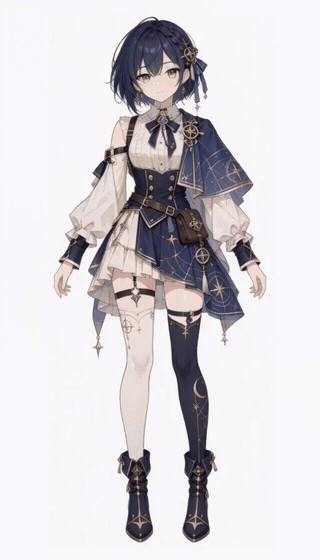</td>
    <td>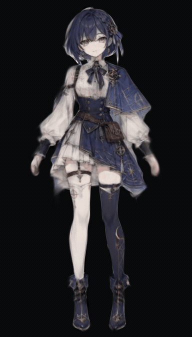</td>
  </tr>
</table>

- [骨架 MP4](docs/assets/demo/v2/pose_control_video_175.mp4)：720×1280、24 FPS、175 幀。
- [生成角色 MP4](docs/assets/demo/v2/generated_character_video.mp4)：512×896、24 FPS、175 幀。
- [Gaussian 環繞 MP4](docs/assets/demo/v2/gaussian_model_orbit.mp4)：512×896、18 FPS、72 幀。
- [V1 預覽與技術文件](docs/versions/README_V1.md)。

## 系統架構說明（Architecture Overview）

系統沒有共用 daemon 或總控 orchestrator。四個 Stage 各自以檔案作為邊界；Stage 1 → 2 與 Stage 2 → 3 需要人工準備輸入，Stage 4 則預設直接讀取 Stage 3 的輸出。外部執行元件包括可自動下載到本機的 DWPose ONNX 模型、ComfyUI、FFmpeg 與 Brush CLI。

- Stage 1 `1_360_skeleton`：對齊角色、估計或補齊關節、渲染骨架環繞、輸出相機 JSON 與 COLMAP text model。
- Stage 2 `2_suround_video`：驗證 ComfyUI workflow 與節點、上傳明確設定的 image/video pair、排程並下載兩個影片輸出。
- Stage 3 `3_virtual_camera`：沿用 Stage 1 pose，解碼 RGB/mask、合成 RGBA、驗證資料契約並輸出 Brush dataset/ZIP；名稱雖含 virtual camera，實作不估計新相機。
- Stage 4 `4_360brush`：驗證 RGBA dataset 與 Brush flags、組成批次命令、保存 log 並確認 PLY 產物。

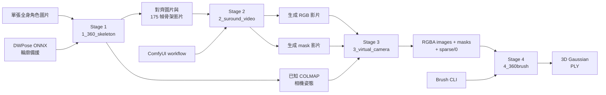

模組依賴只沿著設定檔、workflow、外部 API/CLI 與檔案產物流動，沒有跨 Stage 的 Python import。

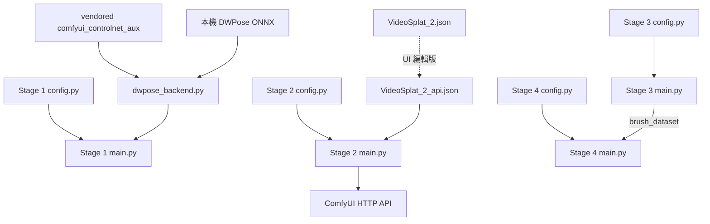

## 系統流程說明（System Flow）

Stage 1 先驗證設定與 FFmpeg，再永遠產生 `default` 固定骨架。初始化 DWPose 時，程式會驗證兩個模型的檔案大小與 SHA-256；缺少或不完整時會從程式內定義的 Hugging Face URL 下載，支援 `.part` 續傳並最多嘗試三次。對 `input/` 中每張支援圖片，程式偵測前景並置中；DWPose 可用時採用模型關節並以輪廓補漏，模型下載、載入或偵測失敗時則回退到輪廓估計。固定 3D 骨架會投影到 175 個水平環繞相機；Frame 0 與 Frame 174 都是正面。

Stage 2 只處理 `INPUT_JOBS` 列出的配對。它驗證 workflow 中恰有一個 `LoadImage`、一個 `LoadVideo`、至少一個 `SaveVideo`，再向 ComfyUI `/system_stats` 與 `/object_info` 檢查服務與節點。正式執行會上傳輸入、提交 `/prompt`、輪詢 `/history/<prompt_id>`，最後從 `/view` 下載輸出。現有 API workflow 有兩個 `SaveVideo`。

Stage 3 要求每組輸入各有一個 `*_output_2_*.mp4` RGB 影片、一個 `*_output_1_*.mp4` mask 影片，以及 Stage 1 的 `colmap/sparse/0/`。FFmpeg 保留原始順序解碼；程式要求 RGB、mask 與 pose 都恰為 175 筆。mask 會依 threshold 轉為 `{0, 255}`，寫入同名 RGB PNG 的 alpha channel，並逐張驗證 alpha 與獨立 mask 完全一致。

Stage 4 掃描 Stage 3 的 group 目錄，抽查 PNG alpha、檢查 Brush 必要 flags、建立訓練命令並將 stdout/stderr 同步寫入 `brush.log`。單組失敗時，預設繼續下一組；Brush 回傳成功後仍會確認 PLY 是否存在且非空。

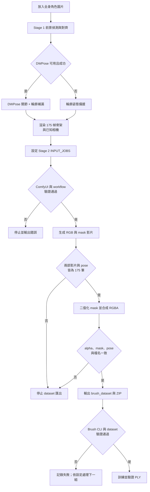

## 資料夾結構說明（Folder Structure）

下列為目前版本庫中實際存在的主要結構。`input/`、`output/`、模型權重與訓練產物大多受 `.gitignore` 排除；Stage 1 的空 `input/` 目前存在於工作區，其餘 Stage 的 runtime 目錄會在準備資料或執行時建立。

```text
VideoSplat/
├── src/
│   ├── 1_360_skeleton/
│   │   ├── input/
│   │   ├── models/README.md
│   │   ├── third_party/comfyui_controlnet_aux/
│   │   ├── config.py
│   │   ├── dwpose_backend.py
│   │   ├── main.py
│   │   └── README.md
│   ├── 2_suround_video/
│   │   ├── workflows/VideoSplat_2.json
│   │   ├── workflows/VideoSplat_2_api.json
│   │   ├── config.py
│   │   └── main.py
│   ├── 3_virtual_camera/
│   │   ├── config.py
│   │   └── main.py
│   └── 4_360brush/
│       ├── config.py
│       └── main.py
├── docs/
│   ├── assets/demo/
│   └── versions/
├── test_file/
│   ├── 1080/
│   ├── Avater/
│   └── suround/
├── .gitattributes
├── .gitignore
├── CHANGELOG.md
├── README.md
├── README_EN.md
└── requirements.txt
```

- `src/1_360_skeleton/`：Stage 1 程式、DWPose bridge、模型放置說明與 vendored DWPose runtime。
- `src/2_suround_video/`：Stage 2 ComfyUI API client，以及 UI 編輯版與 API 執行版 workflow。
- `src/3_virtual_camera/`：Stage 3 known-pose RGBA dataset builder；沒有額外 package 或子模組。
- `src/4_360brush/`：Stage 4 Brush 批次訓練器與參數設定。
- `docs/assets/demo/`：README 使用的 V1/V2 圖片、GIF 與 MP4；`docs/versions/` 保存版本、架構、遷移與 release 文件。
- `test_file/`：已納入版本庫的圖片與影片樣本。`suround/` 內五組影片各為 192 幀，與 V2 Stage 3 固定要求的 175 幀不同，因此不能直接視為現行 Stage 3 合規輸入；`1080/` 有三部 1083 幀影片；`Avater/` 有 black/white 圖片組。

Stage 3 成功輸出格式如下：

```text
src/3_virtual_camera/output/<group>/
├── brush_dataset/
│   ├── images/        # RGBA PNG，名稱沿用 COLMAP images.txt
│   ├── masks/         # 8-bit binary mask
│   └── sparse/0/
│       ├── cameras.txt
│       ├── images.txt
│       └── points3D.txt
└── brush_dataset.zip
```

## 核心模組與重要檔案（Key Modules & Files）

| 檔案 | 職責 | 關聯 |
|---|---|---|
| `src/1_360_skeleton/main.py` | 前景偵測、角色對齊、輪廓備援、3D 骨架投影、影片/COLMAP/JSON 匯出 | 讀取 Stage 1 config；可呼叫 DWPose bridge；以 FFmpeg 編碼影片 |
| `src/1_360_skeleton/config.py` | 720×1280、24 FPS、175 幀、相機、固定骨架、輸入副檔名與渲染參數 | Stage 1 的唯一設定來源 |
| `src/1_360_skeleton/dwpose_backend.py` | 驗證或續傳下載 `yolox_l.onnx` 與 `dw-ll_ucoco_384.onnx`，載入模型並輸出身體與手部關節 | 使用 vendored `comfyui_controlnet_aux`；模型有固定 size 與 SHA-256 |
| `src/2_suround_video/main.py` | 驗證 workflow/server、限制輸入路徑、上傳、排程、輪詢與下載 | 呼叫 ComfyUI HTTP API |
| `src/2_suround_video/workflows/VideoSplat_2_api.json` | 可提交的 MiniMax H3、ControlNet、BiRefNet、SAM3 與雙 `SaveVideo` 圖 | 由 Stage 2 直接載入 |
| `src/2_suround_video/workflows/VideoSplat_2.json` | ComfyUI UI 編輯版 workflow，含節點 metadata 與模型下載資訊 | 不由 Stage 2 Python 直接提交 |
| `src/3_virtual_camera/main.py` | COLMAP text parser、FFmpeg 解碼、mask 二值化、RGBA 合成、資料驗證、ZIP 匯出 | 保留 Stage 1 pose，不做 feature matching 或 camera optimization |
| `src/4_360brush/main.py` | Brush 版本/flag 檢查、dataset 驗證、命令建立、批次執行、log 與 PLY 驗證 | 預設讀取 Stage 3 output |
| `requirements.txt` | 以 `-r` 載入 vendored DWPose requirements | 根目錄唯一 Python 依賴入口 |
| `.gitignore` | 排除 runtime input/output、模型、虛擬環境、PLY、ZIP 與大型媒體 | demo MP4 有明確例外 |

## 安裝與環境需求（Installation & Requirements）

系統與語言需求：

- Python 3.10 或更新版本；原始碼使用 `X | None` 等 Python 3.10 語法。精確測試版號尚未由 lockfile 或 CI 定義。
- FFmpeg，且 `ffmpeg` 必須可由 PATH 執行；Stage 1 用於 H.264 編碼，Stage 3 用於逐幀解碼。
- 首次使用 DWPose 且模型不存在時需要可連線至程式內定義的 Hugging Face 下載位置；不需要 API key。
- 可連線的 ComfyUI，以及 workflow 中所有 custom nodes 與模型。ComfyUI、custom node 與模型的精確相容版本尚未定義。
- 相容的 Brush CLI。程式會從 `--help` 自動辨識 `--total-steps` 或 `--total-train-iters`，並檢查 `REQUIRED_FLAGS`。
- 實際 GPU、VRAM 與 CUDA 需求取決於 ComfyUI 模型和 Brush build；版本庫未定義最低硬體規格。

建立 Python 環境：

```powershell
python -m venv .venv
.\.venv\Scripts\Activate.ps1
python -m pip install --upgrade pip
python -m pip install -r requirements.txt
```

根 `requirements.txt` 會載入 `src/1_360_skeleton/third_party/comfyui_controlnet_aux/requirements.txt`。該檔列出 Torch、OpenCV、NumPy、Pillow、SciPy、ONNX Runtime GPU、MediaPipe、scikit-image、scikit-learn、TorchVision、Hugging Face Hub 等依賴，但沒有固定版本 lock。

Stage 1 會在初始化 DWPose 時自動驗證並下載下列模型至 `src/1_360_skeleton/models/yzd-v/DWPose/`。也可事先放入檔案，但內容必須符合 `dwpose_backend.py` 定義的大小與 SHA-256：

```text
yolox_l.onnx
dw-ll_ucoco_384.onnx
```

Stage 2 API workflow 明確引用以下模型名稱：

- `minimax_h3_video_vae_int8_convrot.safetensors`
- `minimax_h3_ref2va_pruned_int8_convrot.safetensors`
- `qwen3vl_32b_minimax_h3_nvfp4_awq.safetensors`
- `pika_h3_flex_ref2va_comfy_bf16.safetensors`
- `minimax_h3_fun_controlnet_union_pruned_int8_convrot.safetensors`
- `sam3.1_multiplex_fp16.safetensors`，以及 BiRefNet `BiRefNet-general`

必要的雲端 API key、`.env` schema 與 credential 檔案尚未定義。Stage 2 預設使用本機 `http://127.0.0.1:8188`。

## 使用方式（How to Use）

所有命令都從 repository 根目錄執行。

1. 將 PNG/JPG/JPEG/WEBP/BMP 全身圖放入 `src/1_360_skeleton/input/`，執行 Stage 1：

   ```powershell
   python -B src/1_360_skeleton/main.py
   ```

   每張圖會產生獨立 group；`output/default/` 另保存固定骨架。人物 group 包含 `source_aligned.png`、`pose_control_video_175.mp4`、`camera_poses.json`、`pose_detection.json`、預覽圖與 `colmap/`。

2. 把每組 Stage 1 的 `source_aligned.png` 與 `pose_control_video_175.mp4` 放入 `src/2_suround_video/input/<group>/`，並把相對路徑寫入 `src/2_suround_video/config.py` 的 `INPUT_JOBS`。先驗證，再生成：

   ```powershell
   python src/2_suround_video/main.py --check
   python src/2_suround_video/main.py
   ```

3. 在 `src/3_virtual_camera/input/<group>/` 放入 Stage 2 的 output 1 mask 影片、output 2 RGB 影片，以及 Stage 1 的 `colmap/sparse/0/`：

   ```text
   src/3_virtual_camera/input/<group>/
   ├── *_output_1_*.mp4
   ├── *_output_2_*.mp4
   └── colmap/sparse/0/
       ├── cameras.txt
       ├── images.txt
       └── points3D.txt
   ```

   執行 Stage 3：

   ```powershell
   python src/3_virtual_camera/main.py
   ```

4. Stage 4 預設直接掃描 `src/3_virtual_camera/output/` 中的 group：

   ```powershell
   $env:VIDEOSPLAT_BRUSH_EXE = 'C:\path\to\brush-cli.exe'
   python src/4_360brush/main.py
   ```

   成功時輸出位於 `src/4_360brush/output/<group>/`，預設包含 `<group>.ply` 與 `brush.log`。

## 設定說明（Configuration）

| 位置 | 主要設定 | 對行為的影響 |
|---|---|---|
| `src/1_360_skeleton/config.py` | `USE_DWPOSE`、尺寸、FPS、`FRAME_COUNT`、相機半徑/高度/目標、焦距、固定 `JOINTS` | 控制對齊、骨架、相機與 Stage 1 輸出；預設 720×1280、24 FPS、175 幀 |
| `src/2_suround_video/config.py` | `COMFYUI_URL`、`INPUT_JOBS`、workflow path、timeout、output prefix | 控制明確配對、ComfyUI endpoint、輪詢與下載；目前設定列出 group `4`、`5` |
| `VideoSplat_2_api.json` | 模型、prompt、sampling、ControlNet、去背、追蹤與 `SaveVideo` | 控制實際生成圖；Python 只替換 `LoadImage`、`LoadVideo` 與 output prefix |
| `src/3_virtual_camera/config.py` | RGB/mask glob、`EXPECTED_FRAMES`、mask threshold/erosion、RGBA、ZIP、overwrite | 控制資料集建立與驗證；預設要求 175 幀、threshold 127、輸出 ZIP |
| `src/4_360brush/config.py` | steps、splat cap、解析度、SH、seed、alpha、eval、export、viewer、batch error policy | 控制 Brush 命令；預設 50,000 steps、10,000,000 splat cap、2048 最大解析度、SH 3、seed 42 |
| `VIDEOSPLAT_BRUSH_EXE` | Brush executable path | 覆寫 PATH 自動尋找結果 |
| `VIDEOSPLAT_BRUSH_INPUT_DIR` | 含各 group 的輸入根目錄 | 覆寫 Stage 4 預設的 Stage 3 output |

Stage 3 的 `REUSE_ORIGINAL_CAMERA_POSES`、`EXPORT_SEPARATE_MASKS`、`COMPOSE_RGBA_IMAGES` 必須維持 `True`；`ESTIMATE_CAMERAS`、`OPTIMIZE_CAMERAS`、`MATCH_FEATURES` 必須維持 `False`。程式會在不變條件被違反時停止。

## 開發者指南（Developer Guide）

建議閱讀順序：

1. 先讀四個 Stage 的 `config.py`，掌握檔案契約與不可變條件。
2. 讀 Stage 1 `main.py` 與 `dwpose_backend.py`，確認相機、命名、DWPose/輪廓備援與 COLMAP 輸出。
3. 讀 Stage 2 `main.py` 與 `VideoSplat_2_api.json`，確認節點驗證、兩個輸出順序及 API 行為。
4. 讀 Stage 3 的 parser、frame extraction、RGBA composition 與 validation，再讀 Stage 4 command builder。
5. 最後讀 `docs/versions/V2_ARCHITECTURE.md`、遷移指南與 release notes；若文件和程式衝突，以目前 `src/` 與設定檔為準。

修改時必須維持以下契約：Stage 1 的幀數、frame name、相機內參與 `images.txt` 順序必須和 Stage 2/3 一致；調整 Stage 2 `SaveVideo` 數量或順序時，要同步 Stage 3 的 RGB/mask glob；COLMAP image name 不可在 Stage 3 任意改名；更改 Brush flags 時，要同步 `REQUIRED_FLAGS` 與版本偵測。

擴充時優先新增明確設定與邊界驗證。若要自動化前兩個 handoff，應保留每個 Stage 可獨立執行、可檢查中間檔案的特性。`third_party/comfyui_controlnet_aux/` 是 vendored 程式，修改前需同時考量其獨立授權與 upstream 相容性。

目前 repository 沒有 CI 設定、formatter/linter 設定或可執行的自有測試檔。變更後至少應執行 Python 語法檢查、兩份 workflow JSON 解析，以及在具備模型/服務的目標環境做 Stage 2 `--check` 和端到端驗證。

## 已知限制與待辦事項（Limitations & TODO）

- Stage 1 → 2 與 Stage 2 → 3 仍是人工 handoff；Stage 2 `INPUT_JOBS` 也要手動編輯。
- Stage 3 固定要求 175 個 RGB frame、175 個 mask frame 與 175 個 pose，不支援重採樣或其他長度；`test_file/suround/` 的 192 幀樣本不能直接通過此契約。
- DWPose 權重、ComfyUI、custom nodes、workflow 模型與 Brush executable 都不在版本庫；DWPose 可由 Stage 1 自動下載，其餘元件仍需另行準備。依賴沒有 lockfile，最低 GPU/VRAM 也尚未定義。
- V2 沒有 Viewer、共用服務、pipeline orchestrator 或端到端自動測試。`CHANGELOG.md` 與部分版本文件提到 `tests/test_rgba_handoff.py`，但目前工作區實際沒有 `tests/` 目錄或該檔案。
- `points3D.txt` 可為空；Stage 1 本來就不做 feature reconstruction，Stage 3 只複製 text model，Brush 因而可能採 random initialization。
- Stage 4 只抽查前、中、後 PNG 的 alpha header；完整的逐張 alpha/mask 相等驗證由 Stage 3 負責。
- Stage 2 若偵測某組所有編號輸出都已存在就會跳過，不會比對既有輸出是否由目前輸入與 workflow 產生。
- 專案根目錄沒有 LICENSE；只有 vendored `comfyui_controlnet_aux/LICENSE.txt`，因此專案自身授權尚未定義。
- 自有 Python 與 JSON 中沒有 `TODO`、`FIXME`、`XXX` 或 `NotImplemented` 標記；待辦範圍以上述可驗證缺口為準。

## 補充說明（Notes）

`3_virtual_camera` 是既有目錄名稱。程式會複製並驗證 Stage 1 的 `cameras.txt`、`images.txt`、`points3D.txt`，不會呼叫 COLMAP mapper、估計新姿態、最佳化相機或建立虛構 3D points。

Stage 1 另會輸出 COLMAP `rigs.txt` 與 `frames.txt`，但 Stage 3 的 Brush dataset 僅保留 `cameras.txt`、`images.txt`、`points3D.txt`，並要求 `sparse/0/` 中的檔案集合恰好為這三個檔案。

`.gitignore` 排除 `**/input/`、`**/output/`、模型、虛擬環境、ONNX、PLY、ZIP、log 與多數大型媒體；`docs/assets/demo/` 的 MP4 透過例外規則納入版本庫。不要把本機模型、生成資料或 credential 當成原始碼提交。

`test_file/Avater/`、`test_file/suround/` 與其中的 `souce.png` 是目前實際路徑與拼字；程式不直接引用這些路徑。若重新命名，需同步任何工作區外部腳本或人工流程。
