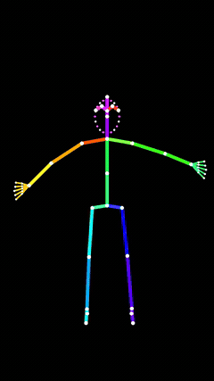
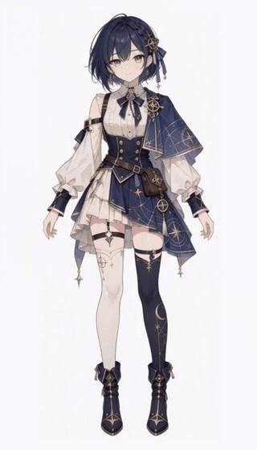
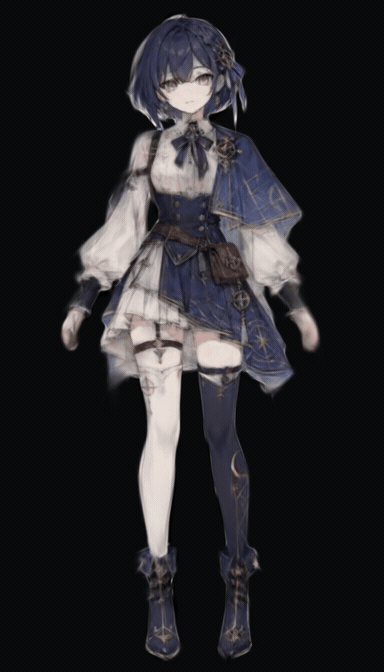
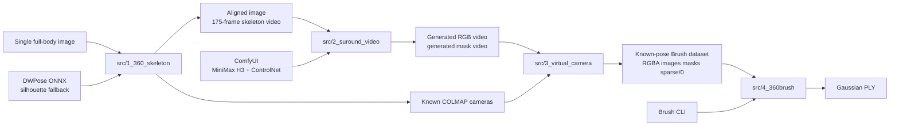
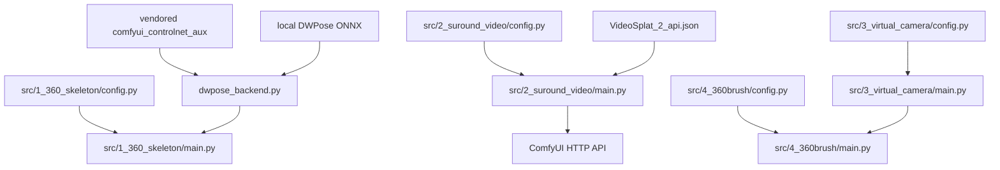
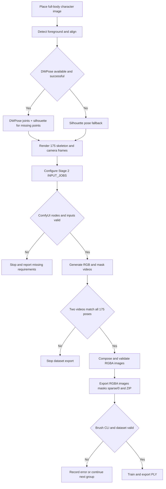

# VideoSplat

**V2.0.0 Release Candidate · Unreleased**

[繁體中文](./README.md) | [English](./README_EN.md) | [CHANGELOG](./CHANGELOG.md) | [GitHub Releases](https://github.com/gkwang4912/VideoSplat/releases) | [V2 Architecture](./docs/versions/V2_ARCHITECTURE.md) | [V1 → V2 Migration Guide](./docs/versions/MIGRATION_V1_TO_V2.md)

| Version | Status | Documentation |
|---|---|---|
| V2.0.0 | Release Candidate / Unreleased | Current README |
| V1.0.0 | Legacy | [V1 中文 README](./docs/versions/README_V1.md) / [English](./docs/versions/README_V1_EN.md) |

## Project Overview

VideoSplat V2 is a file-oriented Python research toolchain. Starting from one full-body character image, it creates a fixed-pose 360-degree skeleton-control video and known camera trajectory, uses ComfyUI to generate character views and masks, combines generated frames with the original poses into a Brush dataset, and trains a 3D Gaussian Splatting (3DGS) PLY.

V2 addresses camera instability by defining the camera path before generated video exists. RGB frames, masks, and COLMAP poses remain aligned in the same 175-frame order. The project targets engineers and researchers working on single-image character view generation, known-pose datasets, and 3DGS reconstruction. It is a four-stage research toolchain with a ComfyUI workflow, not a Python library, persistent service, or complete desktop application.

The three previews below use the actual V2 Stage 1 skeleton video, the Stage 2 generated character video, and an orbit rendered from the Stage 4 `4.ply`. The model preview is loaded directly by the V1 `XYZ Orbit_Viewer` through the `@sparkjsdev/spark` Gaussian renderer, using each Gaussian's position, scale, rotation, opacity, and SH color for real-time sorting and alpha compositing. It is not a point-cloud preview.

<table>
  <tr>
    <th>175-frame skeleton</th>
    <th>Generated character</th>
    <th>Generated model</th>
  </tr>
  <tr>
    <td></td>
    <td></td>
    <td></td>
  </tr>
</table>

- [View the 175-frame skeleton MP4](docs/assets/demo/v2/pose_control_video_175.mp4)
- [View the generated-character MP4](docs/assets/demo/v2/generated_character_video.mp4)
- [View the generated-model MP4](docs/assets/demo/v2/gaussian_model_orbit.mp4)
- [Open the original V1 demos and technical documentation](docs/versions/README_V1_EN.md)

## Architecture Overview

V2 is not an extension of the V1 five-stage pipeline, but it follows the V1 repository layout: all four stages live under `src/` and own separate `input/` and `output/` directories. Users still prepare the Stage 1 → 2 and Stage 2 → 3 handoffs according to the documented contracts. Stage 4 reads the RGBA dataset produced by Stage 3 directly. External runtime components are DWPose models, ComfyUI, FFmpeg, and the Brush CLI.



Module responsibilities and source dependencies are shown below. The `3_virtual_camera` name is retained from the V2 source, but the implementation does not create new cameras; it enforces reuse of Stage 1 poses.



## System Flow

Stage 1 detects the foreground and aligns each input character. When DWPose is available, model joints are used and missing joints are filled from silhouette estimates. If the model cannot load or detect a person, the stage falls back to silhouette estimation. A fixed 3D skeleton is projected through 175 evenly spaced cameras, producing the control video, frame PNGs, camera JSON, and a COLMAP text model.

Stage 2 processes only image/video pairs explicitly listed in `config.py`. It validates the API workflow's `LoadImage`, `LoadVideo`, and `SaveVideo` nodes against ComfyUI `/object_info`, uploads inputs, queues the prompt, polls history, and downloads two video outputs. Stage 3 treats output 1 as the mask and output 2 as RGB, then pairs decoded frames with the original order in Stage 1 `images.txt`.

Stage 3 now owns RGBA conversion. It converts each mask to binary `{0, 255}` alpha, writes that alpha into the matching RGB PNG, and retains the separate `masks/` directory for inspection. Output validation checks every RGBA alpha channel against its mask. Stage 4 reads `src/3_virtual_camera/output/<group>/brush_dataset/` directly, so no manual RGBA preparation or dataset copy is required.



## Folder Structure

```text
VideoSplat/
├── src/
│   ├── 1_360_skeleton/
│   │   ├── main.py
│   │   ├── config.py
│   │   ├── dwpose_backend.py
│   │   ├── models/README.md
│   │   └── third_party/comfyui_controlnet_aux/
│   ├── 2_suround_video/
│   │   ├── main.py
│   │   ├── config.py
│   │   └── workflows/
│   ├── 3_virtual_camera/
│   │   ├── main.py
│   │   └── config.py
│   └── 4_360brush/
│       ├── main.py
│       └── config.py
├── tests/
│   └── test_rgba_handoff.py
├── docs/
│   ├── assets/demo/
│   └── versions/
├── requirements.txt
├── README.md
├── README_EN.md
├── CHANGELOG.md
├── .gitignore
└── .gitattributes
```

- `src/1_360_skeleton/`: character alignment, pose estimation, fixed cameras, video, and COLMAP pose export.
- `src/2_suround_video/`: ComfyUI API client and UI/API workflow JSON files.
- `src/3_virtual_camera/`: RGB/mask decoding, RGBA composition, known-pose reuse, validation, and Brush dataset/ZIP export.
- `src/4_360brush/`: direct Stage 3 dataset input, Brush CLI version checks, batch command construction, logging, and PLY verification.
- `tests/`: offline regression coverage for Stage 3 RGBA composition and the Stage 3 → 4 handoff.
- `docs/versions/`: V1 snapshots, V1/V2 version documents, architecture, migration guide, and release notes.
- Per-stage inputs, outputs, models, virtual environments, and training artifacts remain local and are ignored by Git.

## Key Modules & Files

| File | Responsibility | Relationship |
|---|---|---|
| `src/1_360_skeleton/main.py` | Alignment, pose fallback, skeleton projection, and video/COLMAP/JSON export | Reads Stage 1 config and can call DWPose backend |
| `src/1_360_skeleton/dwpose_backend.py` | Loads local detector/pose ONNX files and returns body/hand joints | Uses vendored `comfyui_controlnet_aux` |
| `src/2_suround_video/main.py` | Validates, uploads, queues, polls, and downloads ComfyUI jobs | Reads API workflow and Stage 2 config |
| `VideoSplat_2_api.json` | Executable generation, background removal, tracking, and dual-video graph | Loaded by Stage 2 main |
| `src/3_virtual_camera/main.py` | Parses COLMAP text, decodes videos, binarizes masks, composes and validates RGBA datasets | Preserves Stage 1 poses; performs no camera estimation |
| `src/4_360brush/main.py` | Validates Stage 3 RGBA datasets and Brush flags, runs batch training, logs, and checks output | Reads Stage 3 output by default |
| `docs/versions/V2_ARCHITECTURE.md` | Technical baseline for V2 facts and contracts | Basis for README and release documents |

## Installation & Requirements

The V2 source environment used Python 3.10.22, and the source syntax requires at least Python 3.10. The repository does not include the original `.pose_env`, model weights, ComfyUI, or Brush binary.

```powershell
python -m venv .venv
.\.venv\Scripts\Activate.ps1
python -m pip install --upgrade pip
python -m pip install -r requirements.txt
```

Install FFmpeg separately and ensure `ffmpeg` is on PATH. Place these DWPose models in `src/1_360_skeleton/models/yzd-v/DWPose/`:

- `yolox_l.onnx`
- `dw-ll_ucoco_384.onnx`

Stage 2 requires a reachable ComfyUI instance. The workflow references a MiniMax H3 UNet/VAE/text encoder, Pika H3 LoRA, MiniMax H3 Fun ControlNet model patch, BiRefNet, and a SAM3.1 checkpoint. Treat the two workflow JSON files as the authoritative filenames. Exact ComfyUI and custom-node versions are not defined.

Stage 4 requires a Brush CLI with the flags checked by the source. If Brush is not on PATH, set:

```powershell
$env:VIDEOSPLAT_BRUSH_EXE = 'C:\path\to\brush-cli.exe'
```

No cloud API key or `.env` file is required. The default ComfyUI endpoint is `http://127.0.0.1:8188`.

## How to Use

Run all commands from the repository root. Stage 4 reads Stage 3 output directly; the first two handoffs still require preparing the documented files.

1. Put full-body PNG/JPG/JPEG/WEBP/BMP files under `src/1_360_skeleton/input/`, then run:

   ```powershell
   python -B src/1_360_skeleton/main.py
   ```

2. For each character, place Stage 1 `source_aligned.png` and `pose_control_video_175.mp4` under `src/2_suround_video/input/<group>/`, then update `INPUT_JOBS` in `src/2_suround_video/config.py`. Validate before generating:

   ```powershell
   python src/2_suround_video/main.py --check
   python src/2_suround_video/main.py
   ```

3. Under `src/3_virtual_camera/input/<group>/`, place the Stage 2 `*_output_1_*.mp4` mask video, `*_output_2_*.mp4` RGB video, and Stage 1 `colmap/sparse/0/`, then run:

   ```powershell
   python src/3_virtual_camera/main.py
   ```

4. Stage 3 creates a validated RGBA dataset at `src/3_virtual_camera/output/<group>/brush_dataset/`. Stage 4 reads that directory by default:

   ```powershell
   python src/4_360brush/main.py
   ```

On success, Stage 4 writes the PLY and `brush.log` under `src/4_360brush/output/<group>/`. Documentation checks cannot replace execution in the target GPU, model, ComfyUI, and Brush environment.

## Configuration

| Location | Setting | Effect |
|---|---|---|
| `src/1_360_skeleton/config.py` | Dimensions, FPS, 175 frames, camera radius/height/target, focal length, fixed joints, DWPose switch | Controls skeleton, cameras, and Stage 1 outputs |
| `src/2_suround_video/config.py` | ComfyUI URL, `INPUT_JOBS`, workflow, timeouts, output prefix | Controls submitted pairs and API behavior |
| `VideoSplat_2_api.json` | Models, prompt, control, sampling, background removal, tracking, save nodes | Controls generation and dual-video output |
| `src/3_virtual_camera/config.py` | Video globs, 175 frames, mask threshold/erosion, RGBA, ZIP, overwrite | Controls dataset building and immutable camera policy |
| `src/4_360brush/config.py` | Stage 3 input, steps, splat cap, resolution, SH, seed, alpha, eval, export, batching | Controls the Brush training command |
| `VIDEOSPLAT_BRUSH_EXE` | Brush executable path | Overrides PATH discovery |
| `VIDEOSPLAT_BRUSH_INPUT_DIR` | Brush group input root | Overrides the default Stage 3 output location |

Do not disable `REUSE_ORIGINAL_CAMERA_POSES` or enable camera estimation, optimization, or feature matching. Stage 3 treats those changes as violations of the V2 experiment invariants and stops.

## Developer Guide

Read `src/1_360_skeleton/config.py`, `main.py`, and `dwpose_backend.py` first. Continue with the Stage 2 config, main module, and API workflow; then read the Stage 3 dataclasses, COLMAP parser, extraction, RGBA composition, and validation; finish with the Stage 4 command builder.

Preserve these contracts when modifying the source: Stage 1 frame count, image names, intrinsics, and `images.txt` order must remain aligned with Stages 2 and 3; changes to Stage 2 `SaveVideo` nodes require matching Stage 3 mask/RGB globs; COLMAP registered image names must not be silently renamed; Brush flag changes require updates to `REQUIRED_FLAGS` and version detection.

Extensions should add explicit configuration and validation instead of scanning arbitrary inputs. Any future automatic handoff should retain the current ability to run each stage independently and inspect intermediate artifacts. The vendored DWPose runtime has its own license and must remain distinct from any future project-level license.

## Limitations & TODO

- V2 has only `tests/test_rgba_handoff.py` for RGBA composition and the Stage 3 → 4 boundary; the rest of the pipeline lacks automated and end-to-end tests.
- V2 has no Viewer. The V1 Viewer exists only in `v1.0.0`.
- Stage 1 → 2 and Stage 2 → 3 still require manual file preparation, and Stage 2 `INPUT_JOBS` editing is manual; Stage 3 → 4 is directly connected.
- Stage 3 requires exactly 175 frames and does not support alternate lengths or pose resampling.
- Stage 3 exports RGBA plus separate masks. The conversion has offline tests but still requires end-to-end validation with actual ComfyUI output and the target Brush environment.
- DWPose, ComfyUI, and Brush depend on external models/binaries without one reproducible environment lockfile.
- `points3D.txt` may be empty, causing Brush to use random initialization.
- The repository has no project-level LICENSE; only vendored dependencies carry their own licenses.
- Project-owned Python/JSON files contain no `TODO`, `FIXME`, `XXX`, or `NotImplemented` marker. The verifiable incomplete scope is listed above.

## Notes

`3_virtual_camera` is the original V2 directory name. Its implementation copies and validates the Stage 1 COLMAP text model; it does not invoke COLMAP mapping, estimate poses, or create fictional 3D points.

The V2 source directory contained a `.pose_env`, ONNX models, input images, generated videos, ZIPs, a PLY, logs, and Brush target data. Those local runtime artifacts are not versioned. The only V2 demo committed here is a reduced GIF, PNG, and MP4 derived from the actual Stage 1 `default` skeleton output. V1 source and root READMEs are available from `v1.0.0`, with readable snapshots under `docs/versions/` on the main branch.
