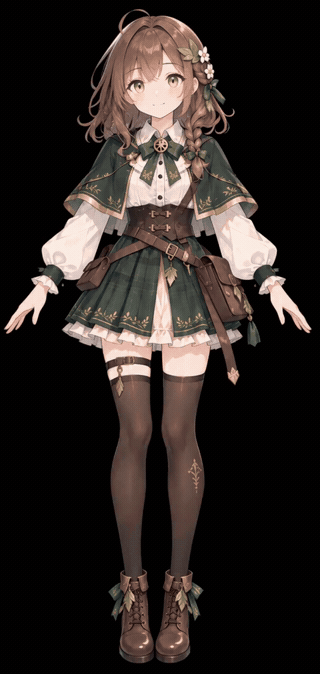
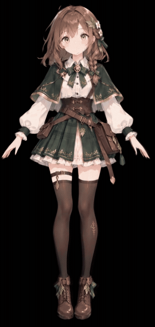
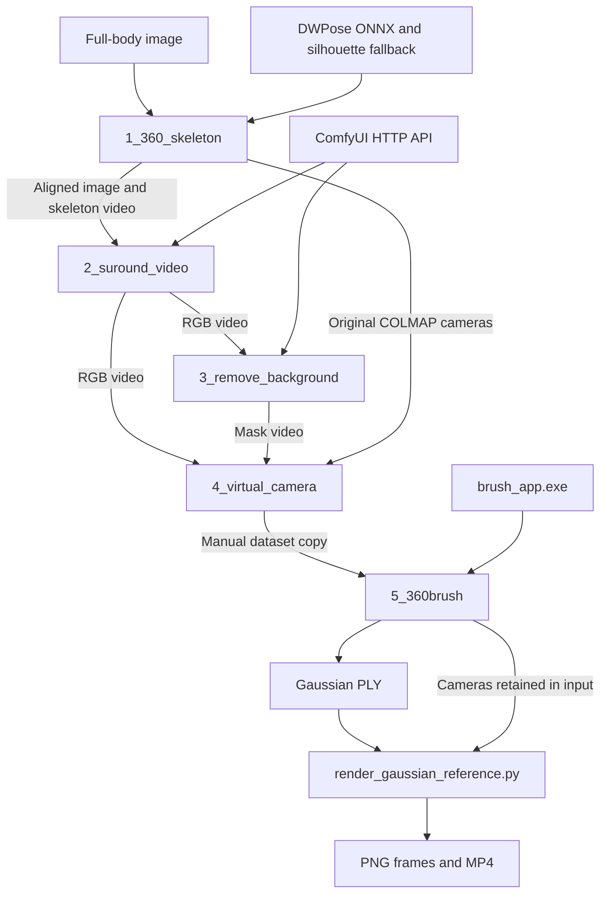
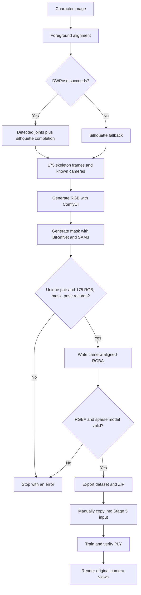
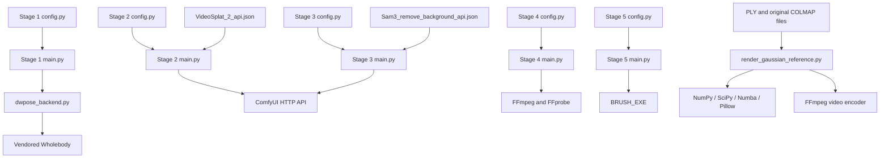

# VideoSplat

**V2.0.0 Release Candidate · Unreleased**

[繁體中文](README.md) | [English](README_EN.md)

## Project Overview

VideoSplat converts a full-body character image into generated views, a camera-aligned training dataset, and a Gaussian Splatting PLY. The current workspace implements five Python stages: skeleton and camera generation, character video synthesis, mask video generation, RGBA dataset assembly, and Brush training.

The camera trajectory is defined before synthesis. Skeleton frames, generated RGB, masks, and camera records are paired by frame order rather than estimating a new trajectory from generated images. This local research toolchain serves engineers and researchers inspecting controlled video generation and known-pose 3D reconstruction.

### Looping previews

The previews embed GIF images directly, without additional link wrappers. All three files use infinite looping (`loop=0`). Full MP4 versions are listed separately below.

The skeleton GIF is generated from `src/4_virtual_camera/input/4/pose_control_video_175.mp4`; the published skeleton MP4 is an exact copy of that source.

<table>
  <tr>
    <th>Skeleton control</th>
    <th>Legacy character</th>
    <th>Legacy Gaussian render</th>
  </tr>
  <tr>
    <td></td>
    <td></td>
    <td></td>
  </tr>
</table>

| Asset | GIF | MP4 |
|---|---|---|
| Skeleton | 320×569, 175 animation frames | [720×1280, 175 frames, 24 FPS](docs/assets/demo/v2/pose_control_video_175.mp4) |
| Legacy character | 320×674, 64 animation frames | [608×1280, 192 frames, 24 FPS](docs/assets/demo/character-2-orbit.mp4) |
| Legacy Gaussian render | 320×674, 60 animation frames | [608×1280, 361 frames, 30 FPS](docs/assets/demo/character-2-3d.mp4) |

The second and third columns reuse the original character 2 demonstrations in `docs/assets/demo/`; they are not generation or reconstruction results for the current character 4. The skeleton column retains character 4's control video described above. GIF thumbnail dimensions and frame counts do not define the current training data contract.

## Architecture Overview

Every stage has its own `config.py`, `input/`, and `output/`. Stages 2 and 3 call ComfyUI through HTTP; Stage 1 uses FFmpeg for encoding; Stage 4 uses FFmpeg and FFprobe for video inspection and decoding; Stage 5 launches a local Brush executable. An additional CPU renderer consumes the resulting PLY and original cameras.



Cross-stage arrows represent file handoffs that users prepare. No pipeline controller transfers these outputs automatically. Stage 5 specifically reads its own `input/`, not Stage 4's output directory.

| Handoff | Required artifacts |
|---|---|
| 1 → 2 | Aligned image and skeleton video under fixed filenames in each immediate character folder |
| 2 → 3 | A selected generated RGB video, placed under the character folder |
| 1, 2, 3 → 4 | Original COLMAP model, RGB video, and a uniquely identifiable mask video |
| 4 → 5 | Complete `brush_dataset/` copied into the Stage 5 input group |
| 5 → renderer | Explicit PLY and original COLMAP paths |

## System Flow

1. Stage 1 always creates the fixed `default` skeleton, then recursively processes character images. It aligns foregrounds, uses DWPose where available, and fills missing joints using silhouette estimates. Initialization or detection errors fall back to silhouette estimation.
2. Stage 2 discovers immediate child folders containing both `source_aligned.png` and `pose_control_video_175.mp4`. It validates server node classes, uploads inputs, queues a prompt, polls history, and downloads RGB video. Its current API workflow has one `SaveVideo` node.
3. Stage 3 discovers videos recursively and uploads them through a streaming multipart request. BiRefNet segments the first frame; SAM3 tracks that mask through the video. Downloaded mask videos preserve the input directory hierarchy and filename stem.
4. Stage 4 samples video pixels to identify one black-and-white mask, then finds one other video with matching width, height, and frame count. RGB, mask, and pose counts must each equal 175. Grayscale mask values become the alpha channel of each PNG, using names and ordering from the original camera model.
5. Stage 5 checks the dataset and Brush flags, trains each group, logs output, and verifies a nonempty PLY. Rendering runs separately against that PLY and the original camera records.



| Condition | Implemented behavior |
|---|---|
| One Stage 1 image fails | Continue other images, record failures in `batch_summary.json`, then raise an error |
| One required Stage 2 input is missing | Stop with the incomplete folder list; folders containing neither required filename are ignored |
| Stage 2 completed job | Skip only when workflow/input SHA-256 signature matches `.completed.json` and recorded outputs exist |
| Stage 3 existing output | Skip by filename; `--force` regenerates and overwrites without an input signature check |
| Stage 4 invalid group | Stop the batch; assemble in a temporary directory before replacing a validated dataset |
| Stage 5 failed group | Continue by default, report failures, and return a nonzero final exit code |

## Folder Structure

This tree includes local runtime artifacts currently present in the workspace; their presence does not imply Git tracks them.

```text
VideoSplat/
|-- src/
|   |-- 1_360_skeleton/
|   |   |-- main.py, config.py, dwpose_backend.py, README.md
|   |   |-- models/yzd-v/DWPose/
|   |   |-- third_party/comfyui_controlnet_aux/
|   |   |-- input/
|   |   `-- output/
|   |-- 2_suround_video/
|   |   |-- main.py, config.py
|   |   |-- workflows/VideoSplat_2.json
|   |   |-- workflows/VideoSplat_2_api.json
|   |   |-- input/
|   |   `-- output/
|   |-- 3_remove_background/
|   |   |-- main.py, config.py
|   |   |-- workflows/Sam3_remove_background.json
|   |   |-- workflows/Sam3_remove_background_api.json
|   |   |-- input/
|   |   `-- output/
|   |-- 4_virtual_camera/
|   |   |-- main.py, config.py
|   |   |-- input/
|   |   `-- output/
|   `-- 5_360brush/
|       |-- main.py, config.py
|       |-- brush_app.exe, brush-cli.exe
|       |-- input/
|       |-- output/
|       `-- target/autotune/
|-- tools/
|   |-- render_gaussian_reference.py
|   |-- render_gaussian_reference.md
|   |-- render_gaussian_orbit.py
|   `-- requirements-renderer.txt
|-- docs/
|   |-- assets/demo/v2/
|   `-- versions/
|-- test_file/
|   |-- Avater/black/
|   |-- Avater/white/
|   |-- suround/1/ ... 5/
|   `-- 1080/
|-- requirements.txt
|-- README.md, README_EN.md, CHANGELOG.md
`-- .gitignore, .gitattributes
```

| Directory | Responsibility |
|---|---|
| `src/1_360_skeleton/models/` | Model placement documentation and downloaded DWPose ONNX files |
| `third_party/comfyui_controlnet_aux/src/custom_controlnet_aux/dwpose/` | Vendored pose inference; `dw_onnx/` and `dw_torchscript/` contain backend-specific processing |
| Stage `input/` and `output/` | Local data; discovery depth and group rules are defined independently by each stage |
| `src/5_360brush/target/autotune/` | Existing Brush/CubeCL tuning cache |
| `tools/` | Offline Gaussian renderers, reproduction guide, and separate dependencies |
| `docs/assets/demo/` | Historical media and current GIF/MP4/PNG previews under `v2/` |
| `docs/versions/` | Version snapshots, architecture, migration, release notes, and version policy; some still describe the earlier four-stage layout |
| `test_file/Avater/` | Black/white character image collections |
| `test_file/suround/1/ ... 5/` | Video, mask, and source image examples; group 4 uses the actual filename `souce.png` |
| `test_file/1080/` | Three `video_latent_refine_*.mp4` examples |

Stage 4 exports the following dataset, without a separate `masks/` folder:

```text
src/4_virtual_camera/output/<group>/
|-- brush_dataset/
|   |-- images/frame000.png ... frame174.png
|   `-- sparse/0/
|       |-- cameras.txt
|       |-- images.txt
|       `-- points3D.txt
`-- brush_dataset.zip
```

Image names follow `images.txt`; the example above uses Stage 1 defaults. Stage 5 expects a copy under `src/5_360brush/input/<group>/brush_dataset/`.

## Key Modules & Files

| File or function | Responsibility |
|---|---|
| [Stage 1 main.py](src/1_360_skeleton/main.py) | `camera_for_frame`, `write_colmap_model`, and `generate_character` produce poses, control video, and diagnostics |
| [dwpose_backend.py](src/1_360_skeleton/dwpose_backend.py) | Model size/hash verification, resumable download, and focused loading of vendored `Wholebody` |
| [Stage 2 main.py](src/2_suround_video/main.py) | Automatic pair discovery, ComfyUI requests, job signatures, and completion records |
| [Generation API workflow](src/2_suround_video/workflows/VideoSplat_2_api.json) | 32 nodes covering MiniMax H3, skeleton ControlNet, LoRA, memory settings, and one video export |
| [Stage 3 main.py](src/3_remove_background/main.py) | Recursive video discovery, streaming upload, output mapping, and forced regeneration |
| [Mask API workflow](src/3_remove_background/workflows/Sam3_remove_background_api.json) | 12 nodes: video loading, first-frame segmentation, SAM3 tracking, and mask export |
| [Stage 4 main.py](src/4_virtual_camera/main.py) | `detect_video_pair`, `write_rgba_images`, validation, original-pose copying, and ZIP creation |
| [Stage 5 main.py](src/5_360brush/main.py) | Steps flag detection, command assembly, subprocess logging, and PLY checks |
| [Preview renderer](tools/render_gaussian_reference.py) | Numeric SH field loading, covariance projection, ordered alpha compositing, and mandatory original COLMAP cameras |
| [Alternative orbit script](tools/render_gaussian_orbit.py) | Automatic framing; its numeric-vector vertical-axis parser cannot directly read this PLY's `Vertical axis: y` |
| [Renderer guide](tools/render_gaussian_reference.md) | Preview reproduction and output descriptions |



## Installation & Requirements

| Requirement | Evidence in the workspace |
|---|---|
| Python | At least 3.10; Stage 4 uses `zip(..., strict=True)`. Exact dependency compatibility versions are not defined |
| Operating system | Current Brush configuration uses Windows executables; a complete deployment procedure for other systems is not defined |
| FFmpeg / FFprobe | Required on PATH for encoding, video inspection, and decoding |
| ComfyUI | Separate server for Stages 2 and 3, both defaulting to `http://127.0.0.1:8188` |
| GPU / VRAM | Minimum generation/training hardware is not defined; the CPU preview renderer does not require CUDA |
| Brush | Local `brush_app.exe` and `brush-cli.exe` exist; Stage 5 selects the former and checks required flags |

From the repository root:

```powershell
python -m venv .venv
.\.venv\Scripts\Activate.ps1
python -m pip install -r requirements.txt
python -m pip install -r tools/requirements-renderer.txt
ffmpeg -version
ffprobe -version
```

The root requirements file includes the vendored requirements list containing Torch, TorchVision, OpenCV, NumPy, Pillow, SciPy, Hugging Face Hub, MediaPipe, ONNX Runtime, and other packages. Renderer dependencies are NumPy, SciPy, Pillow, plyfile, and Numba. Neither list provides a complete version lock.

DWPose downloads `yolox_l.onnx` and `dw-ll_ucoco_384.onnx` into `models/yzd-v/DWPose/`. Their combined expected size is 351,145,849 bytes. Downloads support `.part` resume, size/SHA-256 validation, and up to three attempts. Valid matching files may also be supplied beforehand.

| Workflow | Referenced model |
|---|---|
| Generation | `minimax_h3_ref2va_pruned_int8_convrot.safetensors` |
| Generation | `minimax_h3_video_vae_int8_convrot.safetensors` |
| Generation | `qwen3vl_32b_minimax_h3_nvfp4_awq.safetensors` |
| Generation | `pika_h3_flex_ref2va_comfy_bf16.safetensors` |
| Generation | `minimax_h3_fun_controlnet_union_pruned_int8_convrot.safetensors` |
| Mask | `BiRefNet-general`, `sam3.1_multiplex_fp16.safetensors` |

Custom node installation sources and exact compatible versions are not centrally defined. Compare workflow `class_type` values with server `/object_info` through each stage's `--check`. This checks node presence, not all model contents or successful generation.

No required project API key or `.env` schema is defined. The DWPose bridge defaults `AUX_ORT_PROVIDERS` to `CPUExecutionProvider`. Stage 4 reads `VIDEOSPLAT_BRUSH_EXE` only for its suggested command; Stage 5 uses its own `BRUSH_EXE` setting.

## How to Use

Run commands from the repository root. `<group>` means the same character directory throughout; the current workspace contains group `4`.

1. Place a character image in `src/1_360_skeleton/input/`; the existing `4.png` maps to `output/4/`.

   ```powershell
   python -B src/1_360_skeleton/main.py
   ```

   Inspect alignment and detection diagnostics. Retain the group's `colmap/sparse/0/` for subsequent stages.

2. Copy `source_aligned.png` and `pose_control_video_175.mp4` into `src/2_suround_video/input/<group>/`. Start a prepared ComfyUI server, then run:

   ```powershell
   python -B src/2_suround_video/main.py --check
   python -B src/2_suround_video/main.py
   ```

   RGB outputs are downloaded into `output/<group>/`. There is no `INPUT_JOBS` list to edit.

3. Put the selected RGB video in `src/3_remove_background/input/<group>/`.

   ```powershell
   python -B src/3_remove_background/main.py --check
   python -B src/3_remove_background/main.py
   ```

   The matching relative output location contains the mask video. Add `--force` to regenerate and overwrite an existing output.

4. Put the selected RGB and mask videos, under different filenames, in `src/4_virtual_camera/input/<group>/`, along with Stage 1's `colmap/sparse/0/`.

   ```powershell
   python -B src/4_virtual_camera/main.py
   ```

   Avoid multiple candidate RGB versions. The stage exports `brush_dataset/` and ZIP, replacing the previous dataset by default.

5. Copy the complete dataset to `src/5_360brush/input/<group>/brush_dataset/`, verify the executable setting, and run:

   ```powershell
   python -B src/5_360brush/main.py
   ```

   The default final result is `output/<group>/<group>.ply`, with `brush.log`. Training reruns by default because `SKIP_COMPLETED=False`.

To render the existing model with its training cameras:

```powershell
python -B tools/render_gaussian_reference.py src/5_360brush/output/4/4.ply src/5_360brush/output/4/source_camera_render --colmap src/5_360brush/input/4/brush_dataset/sparse/0 --width 1080 --height 1920 --fps 24 --supersample 2
```

Use `--preview` for four diagnostic views only. A full run produces RGB/alpha PNGs, MP4, and a manifest with source hashes, camera records, and frame statistics. Output dimensions must preserve camera aspect ratio. Camera record count overrides `--frames`. The script does not automatically replace the README GIF.

## Configuration

| Location | Current setting | Effect |
|---|---|---|
| Stage 1 config | 720×1280, 24 FPS, 175 frames; radius 4.8, height 1.45, focal length 1850 px | Controls skeleton projection and camera export |
| Stage 1 config | DWPose, confidence, foreground thresholds, joints, debug indices | Controls detection/fallback and diagnostics; update debug indices if frame count changes |
| Stage 2 config | Input filenames, server URL, 2-second polling, 6-hour generation timeout | Controls discovery and requests; ordinary request timeout is 30 seconds |
| Generation API JSON | Prompt, models, seed, 0.7 image scaling rounded to multiples of 32, length expression | The current 7.1-second parameter resolves to 175 frames independently of Stage 1 config |
| Stage 3 config/API JSON | 1 MiB upload chunks, 30-minute upload timeout; BiRefNet/SAM3 and 24 FPS | Controls transfer, tracking, and mask encoding |
| Stage 4 config | Five 64×64 mask samples, grayscale fraction 0.995, binary fraction 0.98 | Identifies masks; exported alpha itself is not thresholded |
| Stage 4 config | 175 frames, ZIP enabled, overwrite enabled | Sets dataset contract and replacement behavior |
| Stage 5 config | Local `brush_app.exe` | Selects the actual training program without an environment-variable override |
| Stage 5 config | 50,000 steps, 10,000,000 splat cap, max resolution 2048, SH 3, seed 42, alpha weight 0.1 | Builds the training command; optional `None` values are omitted |
| Stage 5 config | Dry run, skip completed, continue on error, extra args/environment | Controls batching and subprocess options |
| Renderer CLI | COLMAP path, dimensions, FPS, supersampling | Selects original camera rendering; light-gray background is currently set in code |

Stage 4 requires original-pose reuse and RGBA composition enabled. Camera estimation, optimization, feature matching, and separate mask export must remain disabled or `require_invariants()` stops execution.

Stage 4's `BRUSH_ALPHA_MODE="transparent"` only affects a printed suggestion. Stage 5 has `ALPHA_MODE=None` and does not send `--alpha-mode`. Its `NO_TIMEOUT` variable is not read by main; training already runs without a timeout.

## Developer Guide

1. Read all five configs, then their `main()` and discovery functions to understand folder depth, naming, and skip behavior.
2. Follow Stage 1 camera creation and COLMAP export into Stage 4's parsers to understand frame correspondence.
3. Inspect Stage 2/3 API workflows and `prepare_workflow`. UI JSON files are editing artifacts; Python submits `*_api.json`. Synchronization is manual.
4. Follow Stage 4 video pairing, RGBA assembly, and validation into Stage 5 command construction.
5. For renderer changes, inspect camera parsing, Gaussian loading, projection, and rasterization; compare the same original camera views.

World coordinates use +Y up and +Z character front. COLMAP stores world-to-camera quaternion `qw,qx,qy,qz` and translation, with camera center `C = -Rᵀt`. The first and final skeleton views are 0° and 360°, both front views.

Changes to frame count must update Stage 1, generation length, and Stage 4 expectations together. Preserve registered image names. Update Brush required flags and steps detection when changing CLI builds. New file-transfer automation needs explicit rerun and multiple-version handling.

There is currently no test directory or CI. These checks parse source and workflow syntax without starting models or services:

```powershell
python -B -c "import ast,pathlib; files=list(pathlib.Path('src').glob('*/*.py'))+list(pathlib.Path('tools').glob('*.py')); [ast.parse(p.read_text(encoding='utf-8-sig')) for p in files]; print('Python syntax OK')"
python -B -c "import json,pathlib; files=list(pathlib.Path('src').glob('*/workflows/*.json')); [json.loads(p.read_text(encoding='utf-8-sig')) for p in files]; print('Workflow JSON OK')"
```

Syntax checks do not replace target-environment generation, dataset validation, and training.

## Limitations & TODO

| Area | Confirmed limitation |
|---|---|
| Geometry | No pose estimation, camera optimization, or feature reconstruction; Stage 1 exports no sparse 3D points |
| Synthesis | No automated verification that generated appearance, pose, or viewpoint exactly follows the control conditions |
| Image/camera dimensions | Current RGBA images are 512×896 while COLMAP declares 720×1280; Stage 4 neither verifies this equality nor recalculates intrinsics. Impact and correction require further validation |
| Masks | Sample-based classification can be ambiguous; alpha preserves grayscale and is checked for nonconstant values, not semantic segmentation correctness |
| Reruns | Stage 2 uses signatures; Stage 3 uses filenames; Stage 5 retrains by default |
| Validation | Stage 5 samples PNG headers; no project test suite, CI, full regression, or unified dependency lockfile |
| Rendering | Reference renderer supports pinhole cameras and SH 0–3; floating Gaussians and blurred model edges remain visible |
| Examples | `test_file/suround/4/` videos have 192 frames and do not satisfy the 175-frame contract |
| Deployment/licensing | Minimum hardware, compatibility matrix, fixed custom node versions, and project-level license are not defined |

No TODO/FIXME/XXX/NotImplemented markers were found in project-owned Python or workflow JSON. The observed gaps suggest these concrete follow-up tasks:

1. Validate image-size/intrinsics handoff with reproducible projection comparisons.
2. Add offline regression checks for frames, masks, RGBA, camera preservation, and PLY outputs.
3. Standardize rerun checks and artifact transfer.
4. Record a compatible set of models, nodes, packages, and Brush builds.
5. Update four-stage historical descriptions where appropriate and define project licensing.

These are documented follow-up items, not implementations included in this README rewrite.

## Notes

Stage 3 produces mask video; transparent RGBA images are assembled by Stage 4. The `4_virtual_camera` directory retains its existing name but copies original cameras rather than creating a new trajectory.

Stage 1 also exports `rigs.txt` and `frames.txt`. Stage 4's output sparse folder must contain exactly `cameras.txt`, `images.txt`, and `points3D.txt`; do not add the other two files back into the assembled dataset.

Git ignores runtime inputs/outputs, model weights, executables, training results, and caches. Existing local ONNX, Brush EXE, and PLY files are not guaranteed in a clean checkout. Demo MP4 files have explicit ignore exceptions; GIFs are not excluded by those media rules.

Version documents and the changelog retain earlier descriptions. Use current source paths for execution. There is no root LICENSE; vendored components carry their own license files, which do not establish licensing for the whole project.
