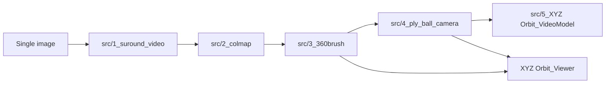

# VideoSplat V1.0.0

**Status:** Current Release  
**Git tag:** `v1.0.0` (not yet created)  
**Release date:** Unreleased

## Version Overview

VideoSplat V1 is a Python-first research toolchain that converts one character image into generated orbit views, estimates camera poses, trains an initial 3D Gaussian Splatting (3DGS) representation, renders controlled spherical camera paths, and prepares refined datasets for a second reconstruction. V1 preserves five numbered pipeline stages and a local Viewer. The stages exchange files rather than using a shared service.

The complete bilingual overview, configuration tables, commands, diagrams, and demos remain in [README.md](../../README.md) and [README_EN.md](../../README_EN.md).

## Core Features

- ComfyUI-based generation of a 360-degree character orbit video and its mask from one image.
- FFmpeg frame extraction, mask cleanup, RGBA production, COLMAP reconstruction, and camera-quality checks.
- Brush CLI training of an initial Gaussian PLY from cleaned RGBA images and COLMAP data.
- Fixed canonical coordinates with six anchors, three 360-degree rings, and twelve 90-degree great-circle camera paths.
- Video-model refinement plus COLMAP, Brush, and Nerfstudio dataset export using traceable camera poses.
- A local XYZ Orbit Viewer for inspecting PLY models, anchors, paths, and rendered images.

## System Architecture



Primary contracts between stages are MP4 videos, RGBA PNG images, COLMAP text models, Gaussian PLY files, per-frame camera JSON, `path_graph.json`, and Nerfstudio `transforms.json`.

## Pipeline Components

| Stage | Purpose | Primary output |
|---|---|---|
| `src/1_suround_video` | Submit a source image to the bundled ComfyUI workflow and retrieve orbit and mask videos | Main MP4 and mask MP4 |
| `src/2_colmap` | Extract frames, clean masks and edges, reconstruct cameras, and validate registration quality | Clean RGBA dataset and COLMAP sparse model |
| `src/3_360brush` | Validate the dataset and invoke Brush training | Gaussian PLY |
| `src/4_ply_ball_camera` | Establish canonical coordinates and render fixed anchors, rings, and paths | Images, masks, videos, camera JSON, and `path_graph.json` |
| `src/5_XYZ Orbit_VideoModel` | Refine path videos and build known-pose reconstruction datasets | COLMAP, Brush, and Nerfstudio datasets |
| `XYZ Orbit_Viewer` | Serve an interactive local inspection UI | Browser-based PLY and trajectory view |

## Installation

V1 requires Python 3.9 or newer, FFmpeg/FFprobe, a CUDA-enabled COLMAP build, a compatible Brush CLI, and CUDA dependencies for Stage 4. Stages 1 and 5 additionally require a running ComfyUI instance with the workflow's models and custom nodes. The Viewer frontend requires Node.js and installs locked packages with `npm ci`.

Use the component requirement files where provided:

```text
python -m pip install -r src/1_suround_video/requirements.txt
python -m pip install -r src/2_colmap/requirements.txt
python -m pip install -r src/4_ply_ball_camera/requirements.txt
```

Exact tested versions of Python, Node.js, ComfyUI, its custom nodes, model weights, COLMAP, and Brush were not recorded for V1. See the maintained [installation section](../../README_EN.md#installation-and-requirements) for details.

## Usage

Run the numbered pipeline stages in order from the repository root:

```text
python src/1_suround_video/main.py
python src/2_colmap/main.py
python src/3_360brush/main.py
python src/4_ply_ball_camera/run.py
python "src/5_XYZ Orbit_VideoModel/main.py" --check
python "src/5_XYZ Orbit_VideoModel/main.py"
```

For the Viewer, run `npm ci` and `npm run build` inside `XYZ Orbit_Viewer`, then start `python "XYZ Orbit_Viewer/app.py"` from the repository root. Detailed input layout and configuration are documented in the [Chinese usage section](../../README.md#使用方式how-to-use) and [English usage section](../../README_EN.md#how-to-use).

## Dependencies

| Dependency | Used by |
|---|---|
| ComfyUI, compatible custom nodes, and local model weights | Stages 1 and 5 |
| FFmpeg and FFprobe | Stages 2, 4, and 5 |
| COLMAP with CUDA support | Stage 2 |
| Brush CLI | Stage 3 and second-stage reconstruction |
| PyTorch, gsplat, CUDA compiler, Visual Studio 2022 C++ tools | Stage 4 |
| Node.js packages locked by `package-lock.json` | XYZ Orbit Viewer frontend |

## Known Limitations

- No LICENSE has been defined, so public source availability does not grant explicit reuse rights.
- No end-to-end automated test covers the entire five-stage workflow.
- Several external tools and model/custom-node versions are not pinned.
- Stage 4 is Windows-specific and defaults the CUDA architecture list to `12.0`.
- Stage 5 intentionally leaves COLMAP `points3D.txt` empty when exporting known camera poses.
- `npm audit` reports one high-severity advisory group for the Viewer development dependency Vite 8.2.2; the available 8.3.5 fix was not applied as part of documentation-only release preparation.
- Comparative Image-to-3D experiments, Gaussian-to-Mesh conversion, rigging, and character animation are outside the implemented V1 pipeline.

## Release Information

V1.0.0 is the initial public release baseline. Its release notes are in [RELEASE_NOTES_V1.md](./RELEASE_NOTES_V1.md), and notable features are recorded in [CHANGELOG.md](../../CHANGELOG.md). At documentation-preparation time, the repository had no `v1.0.0` tag; the release date therefore remains `Unreleased`. The tag should be created only after these release files are committed and reviewed.
