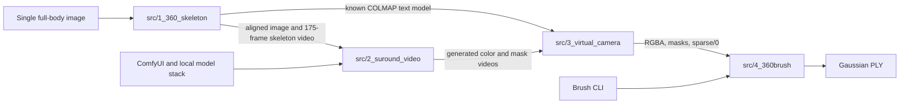
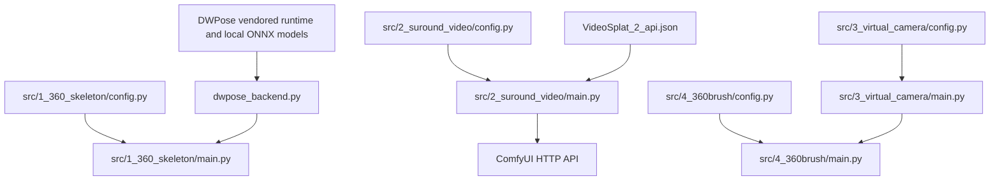

# VideoSplat V2 Architecture

**Status:** V2.0.0 release preparation  
**Source of truth:** the four V2 stage directories under `src/` and their checked-in configuration files

## 1. Architecture summary

V2 is a file-oriented, four-stage Python toolchain. It does not reuse the V1 five-stage design. A deterministic skeleton-control stage creates both a 360-degree control video and the camera model before any generative video is produced. ComfyUI then synthesizes the character views and masks. A dataset builder pairs those generated frames with the original known camera poses, and Brush trains the final 3D Gaussian Splatting model.

There is no shared daemon or pipeline orchestrator. Each stage owns its `input/` and `output/` directories. Users prepare the first two handoffs; Stage 4 reads Stage 3 output directly.



## 2. Stage 1: `src/1_360_skeleton`

### Entry points and configuration

- `main.py`: batch generation, camera construction, image alignment, fallback pose estimation, video writing, and COLMAP export.
- `config.py`: input/output directories, frame/video settings, camera parameters, the fixed 3D skeleton, and rendering colors.
- `dwpose_backend.py`: bridge to the vendored `comfyui_controlnet_aux` DWPose implementation.

### Processing

1. Always render a `default` fixed skeleton.
2. Discover supported images recursively under `input/`.
3. Detect foreground and align each character.
4. Use DWPose when the two local ONNX models are available; fill missing joints from the silhouette estimator. If DWPose fails to load or run, use the silhouette fallback.
5. Convert image-space joints into the fixed 3D coordinate convention.
6. Render 175 frames along a constant-radius horizontal orbit. Frame 0 and frame 174 are both the front view.
7. Export the control MP4, frame PNGs, camera JSON, detection metadata, previews, and COLMAP text files.

### Data contracts

- Resolution: 720 × 1280.
- Frame rate: 24 fps.
- Frame count: 175.
- Camera model: one `SIMPLE_PINHOLE` camera.
- World convention: `+Y` up and `+Z` character front.
- COLMAP poses: world-to-camera `qvec` and `tvec`.
- `points3D.txt`: intentionally empty because the stage defines cameras and does not reconstruct feature points.

## 3. Stage 2: `src/2_suround_video`

### Entry points and configuration

- `main.py`: validates a ComfyUI API workflow, uploads configured jobs, queues prompts, polls history, and downloads each `SaveVideo` output.
- `config.py`: ComfyUI URL, workflow path, input/output directories, explicit `INPUT_JOBS`, timeouts, and filename prefix.
- `workflows/VideoSplat_2_api.json`: executable API workflow.
- `workflows/VideoSplat_2.json`: editable ComfyUI UI workflow.

### Processing

Each configured job contains one aligned source image and one Stage 1 skeleton-control video. The workflow uses a MiniMax H3 reference-to-video path with a Fun ControlNet model patch. It also contains BiRefNet foreground removal and SAM3 video tracking to produce a mask stream. Two `SaveVideo` nodes are present. Stage 3 identifies output 1 as the mask video and output 2 as the color video through its filename globs.

`python src/2_suround_video/main.py --check` validates inputs, workflow node classes, and the running ComfyUI server without submitting generation.

## 4. Stage 3: `src/3_virtual_camera`

Despite its directory name, this stage does not create or optimize new cameras. It builds a Brush dataset while preserving the Stage 1 camera records.

### Invariants enforced by code

- `REUSE_ORIGINAL_CAMERA_POSES = True`.
- Camera estimation, camera optimization, and feature matching are disabled.
- Exactly 175 decoded color frames and 175 decoded mask frames are required.
- COLMAP image names must be safe relative PNG paths.
- Output RGBA/mask counts and dimensions must match registered poses.
- Masks are converted to 8-bit binary values `{0, 255}`.
- Every binary mask is written into the matching RGB image's alpha channel.
- Every RGBA alpha channel must match its retained mask exactly.
- The sparse model must contain exactly `cameras.txt`, `images.txt`, and `points3D.txt`.

### Output

For each immediate child of `input/`, the stage writes:

```text
output/<group>/
├── brush_dataset/
│   ├── images/
│   ├── masks/
│   └── sparse/0/
│       ├── cameras.txt
│       ├── images.txt
│       └── points3D.txt
└── brush_dataset.zip
```

FFmpeg performs frame decoding only; the Python code does not resample viewpoints or estimate poses.

## 5. Stage 4: `src/4_360brush`

### Entry points and configuration

- `main.py`: discovers group directories, validates Brush CLI flags and dataset structure, builds the command, streams output to `brush.log`, and verifies PLY creation.
- `config.py`: Brush executable, training/evaluation/export parameters, dataset subdirectory, batching behavior, and optional extra arguments/environment variables.

The checked-in defaults request 50,000 steps, up to 10,000,000 splats, 2048 maximum input resolution, spherical harmonics degree 3, seed 42, and alpha matching weight 0.1. The executable is resolved from `VIDEOSPLAT_BRUSH_EXE` or PATH. Its input defaults to `src/3_virtual_camera/output/` and can be overridden with `VIDEOSPLAT_BRUSH_INPUT_DIR`.

### Stage 3 → Stage 4 contract

Stage 3 owns the RGBA conversion. It decodes RGB and mask videos, binarizes each mask, writes the mask into the matching image's alpha channel, and validates that alpha and mask are identical. Stage 4 consumes the resulting `output/<group>/brush_dataset/` directly and retains its PNG alpha check as a second boundary validation.

## 6. Module relationships



## 7. Dependencies

- Python 3.10 or newer is required by syntax used in the source. The source environment metadata showed Python 3.10.22, but the environment itself is not versioned.
- FFmpeg is required by Stages 1 and 3.
- DWPose uses the vendored runtime plus two local ONNX model files that are not committed.
- Stage 2 requires a separately installed and configured ComfyUI instance with every node and model named by the workflow.
- Stage 4 requires a compatible Brush CLI. The code detects `--total-steps` versus `--total-train-iters` and checks required flags.

## 8. Implemented and absent capabilities

Implemented behavior is evidenced by source outputs for skeleton videos, generated video/mask pairs, zipped Brush datasets, and a final PLY. Those runtime artifacts are not committed except for the small documentation demo.

V2 contains no current Viewer, no broad automated test suite, no COLMAP feature-based camera estimation, no camera optimization, no sparse point reconstruction, and no automatic transfer for the first two stage handoffs. `tests/test_rgba_handoff.py` covers RGBA composition and the Stage 3 → 4 boundary, which still requires end-to-end validation with actual ComfyUI output and Brush.
